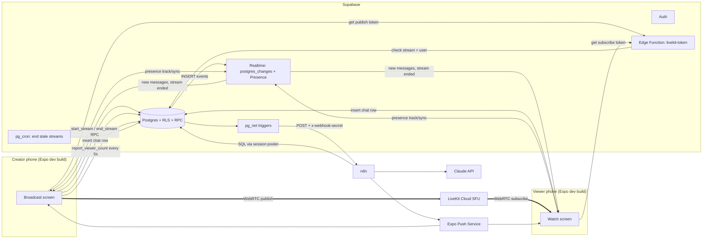
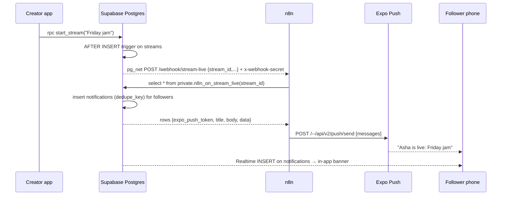
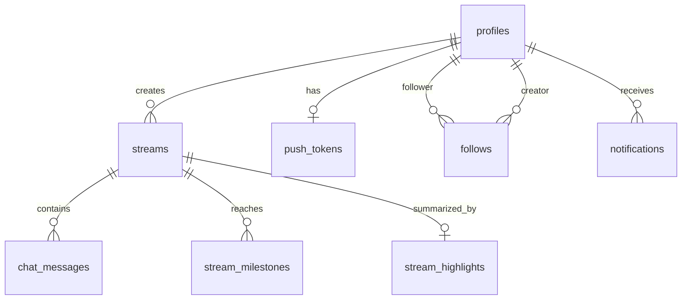

# LiveWire — Real-Time Live Event Broadcasting (Build Blueprint)

> This file is a **complete build blueprint**. It is written for an AI coding agent (and the human supervising it) to build the project from an empty folder to a submitted assessment, in a fixed order, without re-deciding anything.

---

## 0. For the AI agent (read this first)

### 0.1 What you are building

A mobile live-streaming platform. A **creator** opens the app, taps *Go Live*, and broadcasts camera + mic. **Viewers** browse live streams, join, watch the video with sub-second delay, chat in real time, and see a live viewer count. **n8n automations** react to database events: when a stream starts, followers get a push notification; when viewer count crosses milestones (including 100), the creator is alerted; when a stream ends, a highlights recap is generated (busiest chat moments + AI summary); every day a digest of the top streams is sent.

This project implements **Phase 1 (Streaming)** and **Phase 3 (n8n Automation)** of the assignment. **Phase 2 (offline queue) is intentionally NOT built.**

Final deliverables (one GitHub repo):

| Path | Contents |
|---|---|
| `/mobile` | React Native + Expo app (Expo Router, TypeScript), one app with both Creator and Viewer modes |
| `/backend` | Supabase project: SQL migrations, one Edge Function (`livekit-token`), seed script |
| `/n8n-workflow` | 4 exported n8n workflow JSON files + setup notes |
| `README.md` | Final project README (rewrite of this blueprint at the end, see Step 16) |
| `BUILD_LOG.md` | Running build log (see 0.5) |
| `PROMPTS.md` | Prompt history for the "prompt sharing" submission item |

Plus: an installable Android APK link (EAS internal distribution) and a 3-minute Loom video.

### 0.2 Rules

1. **Build step by step in the order of Section 5.** Finish a step, run its *Acceptance check*, log it, then start the next. Do not skip ahead, do not work on two steps at once.
2. **Do not add features beyond Phases 1 and 3.** No offline outbox, no message editing, no VOD/recording, no web app, no admin panel, no categories, no comments on profiles. If a nice idea comes up, write it under "Future work" in `BUILD_LOG.md` and move on.
3. **If something fails after 2 honest attempts, switch to the documented Fallback** for that step. Log what failed and why.
4. **Stop and ask the human only at points marked `ASK USER`.** Everywhere else, use the decisions in this file.
5. **Never invent package versions or API signatures.** Install with `npx expo install <pkg>` (it picks SDK-compatible versions) or `npm install <pkg>` (latest). When this file says *"verify in docs"*, open that doc and follow it over this file if they disagree; log the difference.
6. **Never commit secrets.** `.env`, `google-services.json` service keys, LiveKit secrets, n8n secrets, the Supabase service-role key and DB password stay out of git. Only `.env.example` files are committed.
7. Commit after every step with a message like `step-07: realtime chat`. Keep commits small.
8. Keep files small (< ~250 lines). Screens compose hooks + components; logic lives in `src/hooks` and `src/lib`.

### 0.3 Decisions (already made — do not re-debate)

| Area | Decision | One-line reason |
|---|---|---|
| Phases | **Phase 1 + Phase 3** | Phase 1 is required by everything else; Phase 3 is the only phase that uses n8n, which is part of the required stack, and it produces a visible demo (phone buzzes when a creator goes live). |
| Video | **LiveKit Cloud** (WebRTC SFU) via `@livekit/react-native` + Expo config plugin | Sub-second latency keeps chat in sync with video; official Expo plugin; free tier; we only mint tokens, LiveKit does media routing. |
| Video fallback | (1) pin versions to LiveKit's official Expo example repo; (2) swap to Agora (`react-native-agora`) with the same token-function pattern | The realistic risk is native build breakage, not architecture. |
| Rejected video options | Mux/HLS (10–30 s latency, needs RTMP encoder on phone), raw WebRTC (must build signaling, TURN, SFU fan-out), Agora as primary (fewer Expo-first examples) | Documented for the interview. |
| Backend | **No custom server.** Supabase Postgres + RLS + RPC functions + Realtime + 1 Edge Function | Less to build and deploy; security enforced in the database; Supabase is the required stack. |
| Auth | Supabase email + password, **email confirmation OFF** | Real user IDs for RLS and follows; zero friction for demo accounts. |
| Chat transport | Insert into `chat_messages`; receive via Realtime `postgres_changes` filtered by `stream_id` | Persistence + history + realtime from one write; no socket server. |
| Chat IDs & order | Client generates UUID `id` (idempotent retry); **order by server `seq` (identity column)**, never by client clock | Retries can't duplicate; wrong phone clocks can't scramble order. |
| Viewer count (live UI) | Supabase Realtime **Presence** on channel `stream:{id}`, keyed by `user_id` | Instant, no server code, same user on 2 devices counts once, auto-removed on disconnect. |
| Viewer count (persisted) | Creator app calls RPC `report_viewer_count()` every 5 s (single writer); it updates `current_viewers`, `peak_viewers`, heartbeat, and inserts milestones | One writer = no race; doubles as liveness heartbeat. |
| Milestones | Table `stream_milestones` with PK `(stream_id, milestone)`; thresholds configurable (default `2,10,50,100,500`; `2` exists only so the demo works with two phones) | Primary key makes each alert fire exactly once. |
| n8n trigger design | Postgres triggers → `pg_net` `net.http_post` → n8n Webhook nodes with a shared-secret header | Events come from the source of truth; app code doesn't know n8n exists; fires only on real state transitions. |
| n8n data access | n8n Postgres node over Supabase **session pooler**, calling versioned SQL functions in schema `private` | Queries live in migrations (reviewable), n8n nodes stay one-liners. |
| Notifications | Every automation writes to `notifications` table (in-app inbox via Realtime) **and** sends Expo push when a token exists | Inbox always works; push is a bonus that can fail without breaking the demo. |
| Highlights | "Highlights" = top-3 busiest 30-second chat windows + AI recap (Claude); rule-based recap if AI fails | Real video clipping needs recording/egress + storage — out of scope for 48 h, stated openly. |
| Stale streams | `pg_cron` job every minute ends streams with no heartbeat for 90 s | Creator app crash must not leave a "live" ghost stream. |
| Mobile state | Zustand (session) + TanStack Query (server data) + local `useState` in hooks for realtime lists | Small, standard, easy to explain. |
| Navigation | Expo Router (file-based) | Default in current Expo templates. |
| Builds | Expo **development build** (not Expo Go — LiveKit needs native code); Android-first; APK via EAS internal distribution | iOS needs a paid Apple account; Android APK installs from a link. |
| n8n hosting | n8n Cloud (trial) — fallback: self-hosted Docker + `cloudflared` tunnel | Supabase must reach n8n over public HTTPS. |

### 0.4 Reference repo rule (do-not-copy)

A previous candidate's solution exists at `https://github.com/ANANYA542/LiveCast`. It was studied **only for inspiration** while writing this blueprint. **The implementation must be written independently. Do not clone it into the project, do not copy, paste, or adapt any of its code, SQL, workflow JSON, styles, or text.** This blueprint deliberately uses a different architecture (Supabase instead of Express/Prisma/Redis/Socket.IO). If you find yourself wanting to look at it, re-read this file instead.

### 0.5 BUILD_LOG.md

Create `BUILD_LOG.md` at repo root in Step 0. After **every** step append:

```markdown
## Step N — <title> — <date/time>
- Did: <what was built, files touched>
- Broke: <errors seen, exact messages>
- Fixed: <how> / Fallback used: <yes/no, which>
- Acceptance: <PASS/FAIL + how verified>
- Time spent: <h>
```

Also keep `PROMPTS.md`: after each step, append the human's instruction(s) for that step verbatim (or a faithful summary if they were spoken), so prompt history can be submitted.

---

## 1. Project overview and features

**App name:** LiveWire (change freely). One app, every signed-in user can be both creator and viewer (like Twitch).

### Creator
- Sign up / sign in.
- **Go Live:** enter a title → camera preview → broadcast starts (video + audio).
- See **live viewer count** (updates within ~1 s of someone joining/leaving).
- **Read (and send) chat** in an overlay on top of their own preview.
- **End stream** → lands on a *Stream Summary* screen that shows peak viewers, message count, and highlights once n8n finishes.
- Receives alerts: viewer milestones (in-app + push), highlights ready, daily digest.

### Viewer
- **Browse** live streams (title, creator name, viewer count, live duration), pull-to-refresh.
- **Join and watch** the stream video full screen.
- **Send chat messages**; see everyone's messages in order, in real time.
- **See viewer count** live.
- **Follow** a creator from the watch screen → gets a push + inbox item when that creator goes live.
- Sees "Stream ended" overlay when the creator ends.

### Automation (n8n)
1. **Stream starts → notify followers** (push + inbox).
2. **Viewer milestones (2*, 10, 50, 100, 500) → alert creator** (push + inbox). *`2` is the demo threshold.*
3. **Stream ends → highlights** (busiest moments + AI recap) → saved → creator notified.
4. **Daily digest** of top 5 streams of the last 24 h → saved + sent to all users.

Out of scope (state this in the final README): offline chat queue, message edit/delete, stream recording/VOD, video clip highlights, iOS build, moderation tools.

---

## 2. Architecture



### 2.1 Data flow: video
1. Creator taps *Go Live* → app calls RPC `start_stream(title)` → row in `streams` with `status='live'`, `room_name='stream_<uuid>'`.
2. App calls Edge Function `livekit-token` with `{ streamId }` and the user's JWT. The function verifies the user, loads the stream, and mints a LiveKit JWT: creator gets `canPublish: true`, everyone else `canPublish: false, canSubscribe: true`. TTL 2 h.
3. Creator connects to LiveKit (`wss://<project>.livekit.cloud`) and publishes camera + mic. LiveKit auto-creates the room on first join.
4. Viewer opens the stream → gets a subscribe-only token → connects → renders the creator's camera track.
5. Creator taps *End* → RPC `end_stream(id)` → `status='ended'` → viewers see it via Realtime and disconnect; creator disconnects; LiveKit closes the empty room after its timeout.

**Why an SFU:** the creator uploads one stream; LiveKit's servers (Selective Forwarding Unit) copy it to every viewer. Peer-to-peer would make the phone upload one copy per viewer, which dies at ~3–4 viewers.

### 2.2 Data flow: chat
1. Sender creates `id = randomUUID()` on the phone, shows the message immediately as *sending*.
2. Insert row `{id, stream_id, content}` into `chat_messages`. A `BEFORE INSERT` trigger forces `user_id = auth.uid()`, copies `author_name` from `profiles`, enforces rate limit (5 msgs / 5 s). Postgres assigns `seq` (monotonic) and `created_at`.
3. Supabase Realtime pushes the `INSERT` to every client subscribed with filter `stream_id=eq.<id>` (RLS checked).
4. Each client merges by `id` (replaces the optimistic copy), sorts by `seq`.
5. On retry after a network error, the same `id` is re-sent; a duplicate-key error (`23505`) means "already saved" → treated as success. **No duplicates possible.**
6. If the realtime socket drops and reconnects, client fetches `seq > lastSeenSeq` to fill the gap.

### 2.3 Data flow: viewer count
1. Every client on the watch/broadcast screen joins Realtime channel `stream:{streamId}` with presence key = `user_id`, and calls `track({ role: 'viewer' | 'creator' })`.
2. On every presence `sync` event, count = number of distinct presence keys whose metas include `role: 'viewer'`, excluding the creator's key. Shown in UI immediately.
3. The creator's app calls `report_viewer_count(streamId, count)` every 5 s. That RPC (only callable by the stream's creator) writes `current_viewers`, `peak_viewers = max(peak, count)`, `last_heartbeat_at = now()`, and inserts any newly reached milestones into `stream_milestones` (`ON CONFLICT DO NOTHING`).

### 2.4 Data flow: automations (Phase 3)



| Event | DB source | Webhook path | n8n does |
|---|---|---|---|
| Stream starts | `streams` INSERT/UPDATE to `live` | `/webhook/stream-live` | notify followers |
| Milestone reached | `stream_milestones` INSERT | `/webhook/viewer-milestone` | alert creator |
| Stream ends | `streams` UPDATE `live → ended` (manual or stale cron) | `/webhook/stream-ended` | compute highlights, AI recap, save, notify creator |
| Daily | n8n Schedule Trigger 09:00 | — | top 5 streams → save digest → notify all |

---

## 3. Prerequisites and accounts

### 3.1 Tools (install on the build machine)

| Tool | Version guidance | Check |
|---|---|---|
| Node.js | Current LTS (verify the minimum required by the current Expo SDK in Expo docs → "Installation") | `node -v` |
| npm | comes with Node | `npm -v` |
| Git + GitHub CLI | latest | `git --version`, `gh --version` |
| EAS CLI | latest | `npm i -g eas-cli` → `eas --version` |
| Supabase CLI | use via `npx supabase@latest` (no global install needed) | `npx supabase@latest --version` |
| Android Studio (optional but recommended) | latest; for emulator + local `expo run:android` | `adb devices` |
| Docker Desktop (only if n8n fallback is used) | latest | `docker -v` |
| cloudflared (only if n8n fallback is used) | latest | `cloudflared -v` |

### 3.2 Accounts and keys

> **ASK USER (Step 1):** Request every item below in one message. Do not proceed to Step 2 until the required (R) ones are provided. Store them in the `.env` files from Section 8, never in git.

| # | Service | What to create | Values needed | R/O |
|---|---|---|---|---|
| 1 | **Supabase** (supabase.com) | New project (free tier), region close to the testers. Save the DB password. | Project URL, `anon`/publishable key, `service_role`/secret key, project ref, DB password, **Session pooler connection string** (Dashboard → Connect → Session pooler) | R |
| 2 | Supabase Auth setting | Dashboard → Authentication → Sign In / Providers → Email: **turn OFF "Confirm email"** | — | R |
| 3 | **LiveKit Cloud** (cloud.livekit.io) | New project → Settings → Keys → create API key | `LIVEKIT_URL` (`wss://...livekit.cloud`), `LIVEKIT_API_KEY`, `LIVEKIT_API_SECRET` | R |
| 4 | **Expo / EAS** (expo.dev) | Account; run `eas login` on the build machine | Expo username | R |
| 5 | **n8n** | n8n Cloud trial (n8n.io) → instance URL like `https://<name>.app.n8n.cloud`. *Fallback:* self-host, Section 6.2.7 | n8n base URL, owner login | R |
| 6 | Webhook secret | Generate: `openssl rand -hex 24` | `N8N_WEBHOOK_SECRET` | R |
| 7 | **Firebase** (for Android push) | Firebase project → add Android app with package `com.livewire.app` → download `google-services.json`; Project settings → Service accounts → generate private key JSON (FCM V1) | `google-services.json`, FCM V1 service-account JSON | O (push only; inbox works without) |
| 8 | **Anthropic API** (platform.claude.com) | API key | `ANTHROPIC_API_KEY` (entered only into n8n credentials) | O (rule-based recap without it) |
| 9 | Devices | 1 physical Android phone (creator, needs a real camera) + 1 more Android phone or Android emulator (viewer) | — | R |
| 10 | GitHub | Repo name + public/private | repo URL | R (before first push) |

---

## 4. Database design

### 4.1 Entity overview



| Table | Purpose | Who writes |
|---|---|---|
| `profiles` | display name per auth user | trigger on signup |
| `push_tokens` | Expo push token per user (private) | owner |
| `streams` | stream lifecycle + counts | RPCs only |
| `follows` | follower → creator | follower |
| `chat_messages` | chat, ordered by `seq` | any signed-in user (own rows, live streams only) |
| `stream_milestones` | one row per (stream, milestone) | RPC `report_viewer_count` |
| `notifications` | in-app inbox, deduplicated | n8n via `private.*` functions |
| `stream_highlights` | recap per ended stream | n8n |
| `daily_digests` | one per day | n8n |
| `private.app_config` | n8n URL, secret, milestone list | SQL editor only (not exposed by API) |

### 4.2 Migration SQL

Create with `npx supabase migration new init_schema` inside `/backend` and paste **all blocks below in order** into that one file (`backend/supabase/migrations/<timestamp>_init_schema.sql`). Apply with `npx supabase db push`. (Fallback: paste into Dashboard → SQL Editor and run.)

> If `create extension` fails for `pg_net` or `pg_cron`, enable them in Dashboard → Database → Extensions, then remove those two lines and re-run.

#### Block A — extensions, private schema, config

```sql
-- Extensions
create extension if not exists pg_net with schema extensions;   -- provides net.http_post
create extension if not exists pg_cron;                         -- provides cron.schedule

-- Private schema: not exposed through the Supabase Data API
create schema if not exists private;
revoke all on schema private from public, anon, authenticated;

create table private.app_config (
  key   text primary key,
  value text not null
);

insert into private.app_config (key, value) values
  ('n8n_base_url', ''),                    -- e.g. https://myname.app.n8n.cloud  (no trailing slash) — set in Step 10
  ('n8n_webhook_secret', ''),              -- set in Step 10, never commit the real value
  ('viewer_milestones', '2,10,50,100,500') -- 2 is the demo threshold
on conflict (key) do nothing;
```

#### Block B — tables and indexes

```sql
create table public.profiles (
  id           uuid primary key references auth.users(id) on delete cascade,
  display_name text not null check (char_length(display_name) between 1 and 30),
  created_at   timestamptz not null default now()
);

create table public.push_tokens (
  user_id         uuid primary key references public.profiles(id) on delete cascade,
  expo_push_token text not null,
  updated_at      timestamptz not null default now()
);

create table public.streams (
  id                uuid primary key default gen_random_uuid(),
  creator_id        uuid not null references public.profiles(id) on delete cascade,
  title             text not null check (char_length(title) between 1 and 80),
  status            text not null default 'live' check (status in ('live', 'ended')),
  room_name         text not null unique,
  current_viewers   int  not null default 0 check (current_viewers >= 0),
  peak_viewers      int  not null default 0 check (peak_viewers >= 0),
  started_at        timestamptz not null default now(),
  ended_at          timestamptz,
  last_heartbeat_at timestamptz not null default now()
);
-- A creator can have at most one live stream
create unique index streams_one_live_per_creator on public.streams (creator_id) where status = 'live';
create index streams_status_started_idx on public.streams (status, started_at desc);

create table public.follows (
  follower_id uuid not null references public.profiles(id) on delete cascade,
  creator_id  uuid not null references public.profiles(id) on delete cascade,
  created_at  timestamptz not null default now(),
  primary key (follower_id, creator_id),
  check (follower_id <> creator_id)
);
create index follows_creator_idx on public.follows (creator_id);

create table public.chat_messages (
  id          uuid primary key,                                   -- generated on the phone
  seq         bigint generated always as identity unique,         -- server order
  stream_id   uuid not null references public.streams(id) on delete cascade,
  user_id     uuid not null references public.profiles(id) on delete cascade,
  author_name text not null default '',
  content     text not null check (char_length(trim(content)) between 1 and 500),
  created_at  timestamptz not null default now()
);
create index chat_messages_stream_seq_idx on public.chat_messages (stream_id, seq);
create index chat_messages_user_time_idx  on public.chat_messages (user_id, created_at desc);

create table public.stream_milestones (
  stream_id    uuid not null references public.streams(id) on delete cascade,
  milestone    int  not null,
  viewer_count int  not null,
  reached_at   timestamptz not null default now(),
  primary key (stream_id, milestone)
);

create table public.notifications (
  id         uuid primary key default gen_random_uuid(),
  user_id    uuid not null references public.profiles(id) on delete cascade,
  type       text not null check (type in ('stream_live', 'viewer_milestone', 'highlights_ready', 'daily_digest')),
  title      text not null,
  body       text not null default '',
  data       jsonb not null default '{}'::jsonb,
  dedupe_key text not null,
  read_at    timestamptz,
  created_at timestamptz not null default now(),
  unique (user_id, dedupe_key)
);
create index notifications_user_time_idx on public.notifications (user_id, created_at desc);

create table public.stream_highlights (
  stream_id        uuid primary key references public.streams(id) on delete cascade,
  peak_viewers     int  not null default 0,
  total_messages   int  not null default 0,
  duration_seconds int  not null default 0,
  moments          jsonb not null default '[]'::jsonb,  -- [{start_seconds,end_seconds,message_count,sample:[...]}]
  summary          text not null default '',
  summary_source   text not null default 'rule' check (summary_source in ('ai', 'rule')),
  created_at       timestamptz not null default now()
);

create table public.daily_digests (
  id          uuid primary key default gen_random_uuid(),
  digest_date date not null unique,
  top_streams jsonb not null default '[]'::jsonb,
  created_at  timestamptz not null default now()
);
```

#### Block C — signup trigger and chat trigger

```sql
-- Create a profile row for every new auth user (display_name from sign-up metadata)
create or replace function private.handle_new_user()
returns trigger language plpgsql security definer set search_path = '' as $$
begin
  insert into public.profiles (id, display_name)
  values (
    new.id,
    left(coalesce(nullif(trim(new.raw_user_meta_data ->> 'display_name'), ''), split_part(new.email, '@', 1)), 30)
  );
  return new;
end $$;

create trigger on_auth_user_created
  after insert on auth.users
  for each row execute function private.handle_new_user();

-- Chat: force author, copy name, rate limit
create or replace function private.chat_before_insert()
returns trigger language plpgsql security definer set search_path = '' as $$
declare
  recent int;
begin
  new.user_id := auth.uid();
  if new.user_id is null then
    raise exception 'not_authenticated' using errcode = 'P0001';
  end if;

  select p.display_name into new.author_name from public.profiles p where p.id = new.user_id;

  select count(*) into recent
  from public.chat_messages m
  where m.user_id = new.user_id and m.created_at > now() - interval '5 seconds';
  if recent >= 5 then
    raise exception 'rate_limited' using errcode = 'P0001';
  end if;

  new.content := trim(new.content);
  new.created_at := now();
  return new;
end $$;

create trigger chat_messages_before_insert
  before insert on public.chat_messages
  for each row execute function private.chat_before_insert();
```

#### Block D — RPC functions called by the app

```sql
-- Start a stream (ends any previous live stream of the same creator first)
create or replace function public.start_stream(p_title text)
returns public.streams language plpgsql security definer set search_path = '' as $$
declare
  uid    uuid := auth.uid();
  new_id uuid := gen_random_uuid();
  result public.streams;
begin
  if uid is null then raise exception 'not_authenticated' using errcode = 'P0001'; end if;

  update public.streams
     set status = 'ended', ended_at = now(), current_viewers = 0
   where creator_id = uid and status = 'live';

  insert into public.streams (id, creator_id, title, room_name)
  values (new_id, uid, trim(p_title), 'stream_' || replace(new_id::text, '-', ''))
  returning * into result;

  return result;
end $$;

-- End a stream (idempotent: ending twice returns the ended row)
create or replace function public.end_stream(p_stream_id uuid)
returns public.streams language plpgsql security definer set search_path = '' as $$
declare
  result public.streams;
begin
  update public.streams
     set status = 'ended', ended_at = now(), current_viewers = 0
   where id = p_stream_id and creator_id = auth.uid() and status = 'live'
  returning * into result;

  if result.id is null then
    select * into result from public.streams where id = p_stream_id and creator_id = auth.uid();
    if result.id is null then raise exception 'not_found_or_not_owner' using errcode = 'P0001'; end if;
  end if;
  return result;
end $$;

-- Creator reports presence count every 5 s: updates counts + heartbeat + milestones
create or replace function public.report_viewer_count(p_stream_id uuid, p_count int)
returns void language plpgsql security definer set search_path = '' as $$
declare
  v_count    int := greatest(coalesce(p_count, 0), 0);
  thresholds int[];
begin
  update public.streams
     set current_viewers   = v_count,
         peak_viewers      = greatest(peak_viewers, v_count),
         last_heartbeat_at = now()
   where id = p_stream_id and creator_id = auth.uid() and status = 'live';

  if not found then return; end if;

  select string_to_array(value, ',')::int[] into thresholds
  from private.app_config where key = 'viewer_milestones';

  insert into public.stream_milestones (stream_id, milestone, viewer_count)
  select p_stream_id, m, v_count
  from unnest(coalesce(thresholds, '{}'::int[])) as m
  where v_count >= m
  on conflict (stream_id, milestone) do nothing;
end $$;

-- Only signed-in users may call the RPCs
revoke execute on function public.start_stream(text)              from public, anon;
revoke execute on function public.end_stream(uuid)                from public, anon;
revoke execute on function public.report_viewer_count(uuid, int)  from public, anon;
grant  execute on function public.start_stream(text)              to authenticated;
grant  execute on function public.end_stream(uuid)                to authenticated;
grant  execute on function public.report_viewer_count(uuid, int)  to authenticated;
```

#### Block E — Row Level Security

```sql
alter table public.profiles          enable row level security;
alter table public.push_tokens       enable row level security;
alter table public.streams           enable row level security;
alter table public.follows           enable row level security;
alter table public.chat_messages     enable row level security;
alter table public.stream_milestones enable row level security;
alter table public.notifications     enable row level security;
alter table public.stream_highlights enable row level security;
alter table public.daily_digests     enable row level security;

-- profiles: everyone signed in can read names; you can rename yourself
create policy "profiles read"   on public.profiles for select to authenticated using (true);
create policy "profiles update" on public.profiles for update to authenticated
  using (id = auth.uid()) with check (id = auth.uid());

-- push_tokens: owner only
create policy "push_tokens own select" on public.push_tokens for select to authenticated using (user_id = auth.uid());
create policy "push_tokens own insert" on public.push_tokens for insert to authenticated with check (user_id = auth.uid());
create policy "push_tokens own update" on public.push_tokens for update to authenticated
  using (user_id = auth.uid()) with check (user_id = auth.uid());
create policy "push_tokens own delete" on public.push_tokens for delete to authenticated using (user_id = auth.uid());

-- streams: read-only from the client; writes only through RPCs (security definer)
create policy "streams read" on public.streams for select to authenticated using (true);

-- follows
create policy "follows read"   on public.follows for select to authenticated using (true);
create policy "follows insert" on public.follows for insert to authenticated with check (follower_id = auth.uid());
create policy "follows delete" on public.follows for delete to authenticated using (follower_id = auth.uid());

-- chat: anyone signed in reads; you can only post as yourself, only into a live stream
create policy "chat read" on public.chat_messages for select to authenticated using (true);
create policy "chat insert" on public.chat_messages for insert to authenticated
  with check (
    user_id = auth.uid()
    and exists (select 1 from public.streams s where s.id = stream_id and s.status = 'live')
  );

-- milestones: creator of the stream only
create policy "milestones creator read" on public.stream_milestones for select to authenticated
  using (exists (select 1 from public.streams s where s.id = stream_id and s.creator_id = auth.uid()));

-- notifications: owner reads and marks read
create policy "notifications own read" on public.notifications for select to authenticated using (user_id = auth.uid());
create policy "notifications own update" on public.notifications for update to authenticated
  using (user_id = auth.uid()) with check (user_id = auth.uid());

-- highlights + digests: public to signed-in users
create policy "highlights read" on public.stream_highlights for select to authenticated using (true);
create policy "digests read"    on public.daily_digests     for select to authenticated using (true);
```

#### Block F — n8n event triggers (pg_net) and stale-stream cron

```sql
-- Generic: POST a JSON payload to n8n with the shared secret. Fire-and-forget (pg_net is async).
create or replace function private.notify_n8n(p_path text, p_payload jsonb)
returns void language plpgsql security definer set search_path = '' as $$
declare
  v_base   text;
  v_secret text;
begin
  select value into v_base   from private.app_config where key = 'n8n_base_url';
  select value into v_secret from private.app_config where key = 'n8n_webhook_secret';
  if coalesce(v_base, '') = '' then return; end if;   -- automations not configured yet

  perform net.http_post(
    url     := v_base || p_path,
    body    := p_payload,
    headers := jsonb_build_object('Content-Type', 'application/json', 'x-webhook-secret', v_secret)
  );
end $$;

-- streams: fire on transitions only
create or replace function private.streams_after_change()
returns trigger language plpgsql security definer set search_path = '' as $$
begin
  if new.status = 'live' and (tg_op = 'INSERT' or old.status is distinct from 'live') then
    perform private.notify_n8n('/webhook/stream-live', jsonb_build_object(
      'event', 'stream.live', 'stream_id', new.id, 'creator_id', new.creator_id,
      'title', new.title, 'started_at', new.started_at));
  elsif tg_op = 'UPDATE' and new.status = 'ended' and old.status = 'live' then
    perform private.notify_n8n('/webhook/stream-ended', jsonb_build_object(
      'event', 'stream.ended', 'stream_id', new.id, 'creator_id', new.creator_id,
      'title', new.title, 'started_at', new.started_at, 'ended_at', new.ended_at,
      'peak_viewers', new.peak_viewers));
  end if;
  return new;
end $$;

create trigger streams_notify_n8n
  after insert or update of status on public.streams
  for each row execute function private.streams_after_change();

-- milestones: one webhook per new milestone row
create or replace function private.milestones_after_insert()
returns trigger language plpgsql security definer set search_path = '' as $$
declare
  s public.streams;
begin
  select * into s from public.streams where id = new.stream_id;
  perform private.notify_n8n('/webhook/viewer-milestone', jsonb_build_object(
    'event', 'stream.milestone', 'stream_id', new.stream_id, 'creator_id', s.creator_id,
    'title', s.title, 'milestone', new.milestone, 'viewer_count', new.viewer_count,
    'reached_at', new.reached_at));
  return new;
end $$;

create trigger stream_milestones_notify_n8n
  after insert on public.stream_milestones
  for each row execute function private.milestones_after_insert();

-- End streams whose creator stopped sending heartbeats (app crash / killed)
create or replace function private.end_stale_streams()
returns int language plpgsql security definer set search_path = '' as $$
declare n int;
begin
  update public.streams
     set status = 'ended', ended_at = last_heartbeat_at, current_viewers = 0
   where status = 'live' and last_heartbeat_at < now() - interval '90 seconds';
  get diagnostics n = row_count;
  return n;
end $$;

select cron.schedule('end-stale-streams', '* * * * *', $$select private.end_stale_streams();$$);
```

#### Block G — functions n8n calls (all in `private`, run by the n8n Postgres connection)

Each `n8n_on_*` function inserts inbox notifications **idempotently** (`dedupe_key`) and returns only the push messages for rows that were *newly* inserted, so an n8n retry never double-notifies.

```sql
-- Stream live → notify all followers
create or replace function private.n8n_on_stream_live(p_stream_id uuid)
returns table (expo_push_token text, title text, body text, data jsonb)
language sql security definer set search_path = '' as $$
  with s as (
    select st.id, st.creator_id, st.title, p.display_name
    from public.streams st join public.profiles p on p.id = st.creator_id
    where st.id = p_stream_id and st.status = 'live'
  ),
  ins as (
    insert into public.notifications (user_id, type, title, body, data, dedupe_key)
    select f.follower_id, 'stream_live',
           s.display_name || ' is live', s.title,
           jsonb_build_object('stream_id', s.id),
           'live:' || s.id
    from s join public.follows f on f.creator_id = s.creator_id
    on conflict (user_id, dedupe_key) do nothing
    returning user_id, title, body, data
  )
  select pt.expo_push_token, ins.title, ins.body, ins.data
  from ins join public.push_tokens pt on pt.user_id = ins.user_id;
$$;

-- Milestone → alert creator
create or replace function private.n8n_on_milestone(p_stream_id uuid, p_milestone int)
returns table (expo_push_token text, title text, body text, data jsonb)
language sql security definer set search_path = '' as $$
  with ins as (
    insert into public.notifications (user_id, type, title, body, data, dedupe_key)
    select st.creator_id, 'viewer_milestone',
           p_milestone || '+ viewers watching!',
           '"' || st.title || '" just reached ' || p_milestone || ' viewers.',
           jsonb_build_object('stream_id', st.id, 'milestone', p_milestone),
           'milestone:' || st.id || ':' || p_milestone
    from public.streams st where st.id = p_stream_id
    on conflict (user_id, dedupe_key) do nothing
    returning user_id, title, body, data
  )
  select pt.expo_push_token, ins.title, ins.body, ins.data
  from ins join public.push_tokens pt on pt.user_id = ins.user_id;
$$;

-- Stream ended → one row with stream facts + chat as JSON (always 1 row, so n8n never gets 0 items)
create or replace function private.n8n_highlight_input(p_stream_id uuid)
returns table (
  stream_id uuid, title text, creator_id uuid, peak_viewers int,
  duration_seconds int, total_messages int, messages jsonb
)
language sql stable security definer set search_path = '' as $$
  select s.id, s.title, s.creator_id, s.peak_viewers,
         greatest(0, extract(epoch from (coalesce(s.ended_at, now()) - s.started_at))::int),
         (select count(*)::int from public.chat_messages m where m.stream_id = s.id),
         coalesce((
           select jsonb_agg(jsonb_build_object(
                    'offset_seconds', greatest(0, extract(epoch from (x.created_at - s.started_at))::int),
                    'author_name', x.author_name,
                    'content', x.content) order by x.seq)
           from (select * from public.chat_messages m
                 where m.stream_id = s.id order by m.seq desc limit 2000) x
         ), '[]'::jsonb)
  from public.streams s where s.id = p_stream_id;
$$;

-- Save highlight (upsert). Params are plain values; moments arrives as JSON text.
create or replace function private.n8n_save_highlight(
  p_stream_id uuid, p_moments_json text, p_summary text, p_source text)
returns void language sql security definer set search_path = '' as $$
  insert into public.stream_highlights
    (stream_id, peak_viewers, total_messages, duration_seconds, moments, summary, summary_source)
  select s.id, s.peak_viewers,
         (select count(*)::int from public.chat_messages m where m.stream_id = s.id),
         greatest(0, extract(epoch from (coalesce(s.ended_at, now()) - s.started_at))::int),
         p_moments_json::jsonb, p_summary, p_source
  from public.streams s where s.id = p_stream_id
  on conflict (stream_id) do update
    set moments = excluded.moments, summary = excluded.summary,
        summary_source = excluded.summary_source, total_messages = excluded.total_messages,
        peak_viewers = excluded.peak_viewers, duration_seconds = excluded.duration_seconds,
        created_at = now();
$$;

-- Highlights saved → notify creator
create or replace function private.n8n_on_highlights_ready(p_stream_id uuid)
returns table (expo_push_token text, title text, body text, data jsonb)
language sql security definer set search_path = '' as $$
  with ins as (
    insert into public.notifications (user_id, type, title, body, data, dedupe_key)
    select st.creator_id, 'highlights_ready', 'Your stream recap is ready',
           '"' || st.title || '" — peak ' || st.peak_viewers || ' viewers',
           jsonb_build_object('stream_id', st.id),
           'highlights:' || st.id
    from public.streams st where st.id = p_stream_id
    on conflict (user_id, dedupe_key) do nothing
    returning user_id, title, body, data
  )
  select pt.expo_push_token, ins.title, ins.body, ins.data
  from ins join public.push_tokens pt on pt.user_id = ins.user_id;
$$;

-- Daily digest: compute top 5 of last 24 h, store, notify every user
create or replace function private.n8n_daily_digest()
returns table (expo_push_token text, title text, body text, data jsonb)
language plpgsql security definer set search_path = '' as $$
declare
  v_top   jsonb;
  v_date  date := current_date;
  v_body  text;
begin
  select coalesce(jsonb_agg(t order by t.peak_viewers desc, t.total_messages desc), '[]'::jsonb)
  into v_top
  from (
    select s.id as stream_id, s.title, p.display_name as creator_name, s.peak_viewers,
           (select count(*)::int from public.chat_messages m where m.stream_id = s.id) as total_messages,
           s.started_at
    from public.streams s join public.profiles p on p.id = s.creator_id
    where s.started_at > now() - interval '24 hours'
    order by s.peak_viewers desc, total_messages desc
    limit 5
  ) t;

  insert into public.daily_digests (digest_date, top_streams) values (v_date, v_top)
  on conflict (digest_date) do update set top_streams = excluded.top_streams, created_at = now();

  if jsonb_array_length(v_top) = 0 then
    v_body := 'No streams yesterday. Be the first to go live today!';
  else
    v_body := 'Top stream: "' || (v_top -> 0 ->> 'title') || '" by ' || (v_top -> 0 ->> 'creator_name')
              || ' (' || (v_top -> 0 ->> 'peak_viewers') || ' peak viewers)';
  end if;

  return query
  with ins as (
    insert into public.notifications (user_id, type, title, body, data, dedupe_key)
    select p.id, 'daily_digest', 'Your daily LiveWire digest', v_body,
           jsonb_build_object('digest_date', v_date), 'digest:' || v_date
    from public.profiles p
    on conflict (user_id, dedupe_key) do nothing
    returning user_id, notifications.title, notifications.body, notifications.data
  )
  select pt.expo_push_token, ins.title, ins.body, ins.data
  from ins join public.push_tokens pt on pt.user_id = ins.user_id;
end $$;

-- private functions are never callable from the app
revoke execute on all functions in schema private from public, anon, authenticated;
```

> Note on `n8n_daily_digest`: inside PL/pgSQL, output column names (`title`, `body`, `data`) can clash with table columns; the `returning ... notifications.title` qualification avoids that. If Postgres still reports "column reference is ambiguous", rename the output columns to `out_title`, `out_body`, `out_data` and adjust the n8n Code node.

#### Block H — Realtime publication

```sql
alter publication supabase_realtime add table
  public.chat_messages, public.streams, public.notifications, public.stream_highlights;
```

### 4.3 Realtime channel and presence design

| Channel | Who joins | Listens to | Presence |
|---|---|---|---|
| `stream:{streamId}` | creator (broadcast screen) and viewers (watch screen) | `postgres_changes` INSERT on `chat_messages` filter `stream_id=eq.{streamId}`; UPDATE on `streams` filter `id=eq.{streamId}` | key = `user_id`; payload `{ role: 'creator' \| 'viewer', joined_at }` |
| `inbox:{userId}` | every signed-in user (app root) | `postgres_changes` INSERT on `notifications` filter `user_id=eq.{userId}` | none |
| `summary:{streamId}` | creator on summary screen | `postgres_changes` INSERT/UPDATE on `stream_highlights` filter `stream_id=eq.{streamId}` | none |

**Viewer count rule:** `count = number of presence keys (excluding creator_id) where any meta has role 'viewer'`. Same user on two devices = one key = counted once.

---

## 5. Step-by-step build flow

**Time plan (≈31 h of work inside 48 h; leaves ~17 h for sleep, breaks and overruns).**

| Step | Title | Budget |
|---|---|---|
| 0 | Repo scaffold, logs | 0.5 h |
| 1 | Accounts and keys (ASK USER) | 1 h |
| 2 | Database migration | 1.5 h |
| 3 | Expo app scaffold + native deps + first dev build | 2.5 h |
| 4 | Auth screens + session | 1.5 h |
| 5 | LiveKit token Edge Function | 1.5 h |
| 6 | Creator: go live / broadcast / end | 2.5 h |
| 7 | Viewer: browse + watch video | 2 h |
| 8 | Realtime chat | 2.5 h |
| 9 | Presence viewer count + heartbeat RPC | 2 h |
| 10 | n8n setup + Workflow 1 (stream live → followers) + follows + inbox | 3 h |
| 11 | Push notifications (Expo + FCM) | 2 h |
| 12 | Workflow 2 (milestones) | 1 h |
| 13 | Workflow 3 (highlights) + summary screen | 2.5 h |
| 14 | Workflow 4 (daily digest) | 1 h |
| 15 | Hardening + preview APK build | 2 h |
| 16 | Docs, exports, testing checklist, Loom | 2 h |

**If behind schedule, cut in this order:** (1) AI recap → rule-based only; (2) push notifications → inbox only; (3) rate limiting trigger; (4) daily digest emails/extra formatting. Never cut: live video, chat, presence count, the 4 workflows existing and exported.

---

### Step 0 — Repo scaffold

- **Goal:** empty monorepo with the required folders and logs.
- **Files:** `/mobile/`, `/backend/`, `/n8n-workflow/`, `.gitignore`, `BUILD_LOG.md`, `PROMPTS.md`, `README.md` (copy of this blueprint for now).
- **Commands:**
  ```bash
  mkdir livewire && cd livewire && git init
  mkdir backend n8n-workflow
  printf "node_modules/\n.env\n.env.*\n!.env.example\n*.keystore\n*.jks\ngoogle-services.json\nfcm-service-account*.json\n.expo/\ndist/\nandroid/\nios/\nsupabase/.temp/\n.DS_Store\n" > .gitignore
  touch BUILD_LOG.md PROMPTS.md
  ```
- **Notes:** `android/` and `ios/` are generated by Expo prebuild; do not commit them (Continuous Native Generation).
- **Acceptance:** `git status` shows the folders and files; `.gitignore` contains `.env` and `google-services.json`.
- **Fallback:** n/a.
- **Time:** 0.5 h.

### Step 1 — Accounts and keys

- **Goal:** every credential from Section 3.2 is available.
- **ASK USER:** send the table from 3.2 and ask for values (R items required). Ask for the GitHub repo name/visibility. Ask which device is the creator phone.
- **Files:** `backend/.env` and `mobile/.env` filled from Section 8 (not committed).
- **Commands:** `eas login`, `npx supabase@latest login`.
- **Acceptance:** `eas whoami` prints the username; Supabase dashboard shows "Confirm email" disabled; LiveKit dashboard shows an API key.
- **Fallback:** If n8n Cloud trial is unavailable → plan for self-hosted n8n (Section 6.2.7). If no second phone → Android emulator as viewer.
- **Time:** 1 h (mostly waiting on the human).

### Step 2 — Database migration

- **Goal:** all tables, RLS, RPCs, triggers, cron, realtime publication live in Supabase.
- **Files:** `backend/supabase/config.toml` (generated), `backend/supabase/migrations/<ts>_init_schema.sql` (Blocks A–H), `backend/supabase/seed.sql` (empty for now).
- **Commands:**
  ```bash
  cd backend
  npx supabase@latest init
  npx supabase@latest link --project-ref <PROJECT_REF>
  npx supabase@latest migration new init_schema
  # paste Blocks A–H into the new file
  npx supabase@latest db push
  ```
- **Notes:** `private.app_config` values for n8n stay empty until Step 10 — triggers simply return early, so nothing breaks.
- **Acceptance (run in SQL editor):**
  ```sql
  select table_name from information_schema.tables where table_schema = 'public' order by 1;   -- 9 tables
  select * from cron.job;                                                                       -- end-stale-streams present
  select tablename from pg_publication_tables where pubname = 'supabase_realtime';              -- 4 tables
  ```
  Then in Dashboard → Authentication → Users → "Add user" create `test1@example.com` with metadata — or sign up later from the app — and confirm a `profiles` row appears.
- **Fallback:** `db push` errors → paste the SQL into the Dashboard SQL editor block by block; fix the failing block; then mark it applied with `npx supabase@latest migration repair --status applied <timestamp>` so CLI and DB agree (verify in Supabase CLI docs → `migration repair`).
- **Time:** 1.5 h.

### Step 3 — Expo app scaffold + all native deps + first dev build

- **Goal:** a development build installed on the Android phone that already contains every native module we will need (so we rebuild as rarely as possible).
- **Files:** `mobile/` (template), `mobile/app.json`, `mobile/eas.json`, `mobile/.env`, `mobile/src/lib/supabase.ts`.
- **Commands:**
  ```bash
  # 1) Check which Expo SDK LiveKit supports TODAY:
  #    open https://github.com/livekit-examples (find the React Native Expo quickstart repo),
  #    read its package.json "expo" version. Use that SDK if the latest Expo SDK is not yet supported.
  npx create-expo-app@latest mobile          # default template: TypeScript + Expo Router
  cd mobile
  npm run reset-project                      # removes example screens (script ships with the default template; skip if absent)

  # Video (verify exact package list in LiveKit docs → "Expo quickstart")
  npx expo install @livekit/react-native @livekit/react-native-expo-plugin @livekit/react-native-webrtc @config-plugins/react-native-webrtc livekit-client

  # Supabase client (verify in Supabase docs → "Use Supabase with Expo React Native")
  npx expo install @supabase/supabase-js @react-native-async-storage/async-storage react-native-url-polyfill

  # Everything else native we will need later
  npx expo install expo-dev-client expo-notifications expo-device expo-constants expo-crypto
  npm install zustand @tanstack/react-query

  eas init                                    # creates EAS project, writes extra.eas.projectId
  eas build:configure                         # creates eas.json
  ```
- **`app.json` essentials** (merge into what the template generated):
  ```json
  {
    "expo": {
      "name": "LiveWire",
      "slug": "livewire",
      "scheme": "livewire",
      "android": {
        "package": "com.livewire.app",
        "permissions": ["android.permission.CAMERA", "android.permission.RECORD_AUDIO", "android.permission.MODIFY_AUDIO_SETTINGS"],
        "googleServicesFile": "./google-services.json"
      },
      "ios": {
        "bundleIdentifier": "com.livewire.app",
        "infoPlist": {
          "NSCameraUsageDescription": "LiveWire uses the camera to broadcast your live stream.",
          "NSMicrophoneUsageDescription": "LiveWire uses the microphone to broadcast your live stream."
        }
      },
      "plugins": [
        "expo-router",
        "@livekit/react-native-expo-plugin",
        "@config-plugins/react-native-webrtc",
        "expo-notifications"
      ]
    }
  }
  ```
  Remove the `googleServicesFile` line if `google-services.json` was not provided yet (add it back in Step 11 and rebuild).
- **`eas.json` build profiles** (edit what `eas build:configure` generated; the anon key is public by design):
  ```json
  {
    "build": {
      "development": {
        "developmentClient": true,
        "distribution": "internal",
        "android": { "buildType": "apk" },
        "env": { "EXPO_PUBLIC_SUPABASE_URL": "https://<ref>.supabase.co", "EXPO_PUBLIC_SUPABASE_ANON_KEY": "<anon-key>" }
      },
      "preview": {
        "distribution": "internal",
        "android": { "buildType": "apk" },
        "env": { "EXPO_PUBLIC_SUPABASE_URL": "https://<ref>.supabase.co", "EXPO_PUBLIC_SUPABASE_ANON_KEY": "<anon-key>" }
      }
    }
  }
  ```
- **`src/lib/supabase.ts`:** create client with `AsyncStorage` as auth storage, `autoRefreshToken: true`, `persistSession: true`, `detectSessionInUrl: false`; add an `AppState` listener that calls `supabase.auth.startAutoRefresh()` on `active` and `stopAutoRefresh()` otherwise (exact snippet: Supabase docs → Expo React Native quickstart).
- **Entry polyfill:** in `app/_layout.tsx`, at module top: `import { registerGlobals } from '@livekit/react-native'; registerGlobals();` (verify in LiveKit Expo docs).
- **Build + run:**
  ```bash
  eas build --profile development --platform android   # install APK on phone via the link/QR
  npx expo start --dev-client                          # phone opens the dev build and loads JS
  ```
  *Faster alternative if Android Studio is installed:* `npx expo run:android` (builds locally, installs on the connected device/emulator).
- **Acceptance:** the dev build launches on the phone and shows the placeholder screen; editing a text in `app/index.tsx` hot-reloads.
- **Fallback:** (1) Build fails on LiveKit/WebRTC → scaffold again with the exact Expo SDK and package versions from LiveKit's Expo example repo (`npx create-expo-app@latest mobile --template default@sdk-<N>`), (2) still failing after 2 attempts → Agora path: replace LiveKit packages with `react-native-agora` (+ its Expo config instructions from Agora docs), keep everything else; token function then uses Agora's token builder. Log the switch.
- **Time:** 2.5 h (EAS queue may take 10–40 min — work on Step 4 code meanwhile).

### Step 4 — Auth screens + session

- **Goal:** sign up (email, password, display name), sign in, sign out, persistent session, route guard.
- **Files:**
  - `src/stores/session.ts` — Zustand: `{ session, profile, setSession }`.
  - `app/_layout.tsx` — `QueryClientProvider`; subscribe to `supabase.auth.onAuthStateChange`; redirect: no session → `/(auth)/sign-in`, session → `/(app)/(tabs)`.
  - `app/(auth)/sign-in.tsx`, `app/(auth)/sign-up.tsx`.
  - `app/(app)/_layout.tsx` (Stack), `app/(app)/(tabs)/_layout.tsx` (Tabs: Live, Go Live, Inbox, Profile), placeholder tab screens.
- **Notes:** sign-up uses `supabase.auth.signUp({ email, password, options: { data: { display_name } } })` → DB trigger creates the profile. Profile tab shows display name + Sign out.
- **Acceptance:** create two accounts (`creator@test.dev`, `viewer@test.dev`); kill and reopen app → still signed in; `profiles` table has 2 rows with the right names.
- **Fallback:** if sign-up returns "email not confirmed", the "Confirm email" toggle is still on → turn off (ASK USER if no dashboard access).
- **Time:** 1.5 h.

### Step 5 — LiveKit token Edge Function

- **Goal:** `POST /functions/v1/livekit-token { streamId }` → `{ token, url, role }`.
- **Files:** `backend/supabase/functions/livekit-token/index.ts`, `backend/.env` (local only).
- **Code (verify imports in Supabase Edge Functions docs and LiveKit server SDK docs; in `livekit-server-sdk` v2 `toJwt()` is async):**
  ```ts
  import { createClient } from "npm:@supabase/supabase-js@2";
  import { AccessToken } from "npm:livekit-server-sdk@2";

  const json = (body: unknown, status = 200) =>
    new Response(JSON.stringify(body), { status, headers: { "Content-Type": "application/json" } });

  Deno.serve(async (req) => {
    if (req.method !== "POST") return json({ error: "method_not_allowed" }, 405);
    const authHeader = req.headers.get("Authorization");
    if (!authHeader) return json({ error: "unauthorized" }, 401);

    // Client acting AS the caller, so RLS applies
    const supabase = createClient(
      Deno.env.get("SUPABASE_URL")!,
      Deno.env.get("SUPABASE_ANON_KEY")!,
      { global: { headers: { Authorization: authHeader } } },
    );
    const { data: { user }, error: userErr } = await supabase.auth.getUser();
    if (userErr || !user) return json({ error: "unauthorized" }, 401);

    const { streamId } = await req.json().catch(() => ({}));
    if (!streamId) return json({ error: "stream_id_required" }, 400);

    const { data: stream } = await supabase
      .from("streams").select("id, creator_id, status, room_name").eq("id", streamId).single();
    if (!stream) return json({ error: "stream_not_found" }, 404);
    if (stream.status !== "live") return json({ error: "stream_not_live" }, 409);

    const isCreator = stream.creator_id === user.id;
    const at = new AccessToken(Deno.env.get("LIVEKIT_API_KEY")!, Deno.env.get("LIVEKIT_API_SECRET")!, {
      identity: user.id,
      ttl: "2h",
    });
    at.addGrant({
      room: stream.room_name,
      roomJoin: true,
      canPublish: isCreator,
      canSubscribe: true,
      canPublishData: false,
    });

    return json({ token: await at.toJwt(), url: Deno.env.get("LIVEKIT_URL"), role: isCreator ? "creator" : "viewer" });
  });
  ```
- **Commands:**
  ```bash
  cd backend
  npx supabase@latest functions new livekit-token
  npx supabase@latest secrets set LIVEKIT_URL=wss://<x>.livekit.cloud LIVEKIT_API_KEY=<key> LIVEKIT_API_SECRET=<secret>
  npx supabase@latest functions deploy livekit-token
  ```
  `SUPABASE_URL` and `SUPABASE_ANON_KEY` are injected automatically into Edge Functions (verify in Supabase docs → Edge Functions → "Default secrets"; with the newer key system the name may be `SUPABASE_PUBLISHABLE_KEY`).
- **Acceptance:** from the app (temporary debug button) or curl with a user access token: live stream id → 200 with a token; paste the token into LiveKit's JWT decoder in the dashboard (or jwt.io) → `video.canPublish` true for creator, false for viewer. Ended stream → 409.
- **Fallback:** `functions deploy` needs Docker on some CLI versions → try `--use-api` flag (verify in CLI help). 401 from the gateway with new API keys → deploy with `--no-verify-jwt` (the function verifies the user itself).
- **Time:** 1.5 h.

### Step 6 — Creator: go live, broadcast, end

- **Goal:** creator enters title → starts broadcasting camera + mic → ends.
- **Files:**
  - `app/(app)/(tabs)/go-live.tsx` — title input + "Go Live" button; requests camera/mic permission first (the LiveKit/WebRTC permission flow, or `PermissionsAndroid` on Android).
  - `src/lib/streams.ts` — `startStream(title)`, `endStream(id)`, `fetchLiveKitToken(streamId)` (uses `supabase.functions.invoke('livekit-token', { body: { streamId } })`).
  - `app/(app)/broadcast/[id].tsx` — `<LiveKitRoom serverUrl token connect audio video>`; inside it a `<LocalPreview/>` rendering the local camera track; top bar with LIVE badge + viewer count placeholder; **End** button (confirm dialog).
  - `src/components/LocalPreview.tsx`.
- **Notes:**
  - Use the component/hook names from the LiveKit Expo quickstart for your installed version (`LiveKitRoom`, `useTracks`, `VideoTrack` or `VideoView`, `AudioSession.startAudioSession()` / `stopAudioSession()`). Do not guess; copy the patterns from the official quickstart.
  - On End: `endStream(id)` → disconnect → `router.replace('/summary/' + id)` (screen built in Step 13; placeholder for now).
  - Handle Android back button on broadcast screen = same confirm-end dialog.
- **Acceptance:** creator phone shows its own camera; LiveKit Cloud dashboard → Sessions shows the room `stream_<uuid>` with 1 participant publishing video + audio; `streams` row is `live`; tapping End → row is `ended` with `ended_at`.
- **Fallback:** black preview → check camera permission granted and that `registerGlobals()` runs before anything else; still black after 2 attempts → follow LiveKit Expo example verbatim for the screen; then Agora path (Step 3 fallback).
- **Time:** 2.5 h.

### Step 7 — Viewer: browse + watch

- **Goal:** viewer sees live streams and watches one.
- **Files:**
  - `app/(app)/(tabs)/index.tsx` — TanStack Query: `streams` where `status='live'` and `last_heartbeat_at > now - 60s` (compute ISO timestamp client-side), join creator name: `.select('id,title,current_viewers,started_at,creator:profiles(display_name)')`, `refetchInterval: 10000`, pull-to-refresh. Card: title, creator, 👁 count, "live for 12 min". Empty state.
  - `app/(app)/watch/[id].tsx` — fetch token → `<LiveKitRoom connect audio={false} video={false}>` (does not publish) → `<RemoteStage/>` renders the first remote camera track full screen; "Waiting for video…" placeholder.
  - `src/components/RemoteStage.tsx`.
- **Acceptance:** with creator live on phone A, phone B (viewer account) sees the stream in the list within 10 s, opens it, sees and hears the creator with ≤1 s visible delay (wave a hand).
- **Fallback:** no remote video but audio works → check that the creator publishes `Track.Source.Camera` and the viewer subscribes to that source; emulator video decoding issues → use a second physical phone or test viewer on the emulator with audio only and log it.
- **Time:** 2 h.

### Step 8 — Realtime chat

- **Goal:** chat on watch + broadcast screens, ordered, no duplicates, shows failures.
- **Files:**
  - `src/hooks/useStreamChannel.ts` — creates **one** channel `stream:{id}` per screen with presence key `user.id`; registers chat INSERT listener and stream UPDATE listener; exposes `channel`, `status`. (Step 9 adds presence to the same channel.)
  - `src/hooks/useChat.ts` — state + logic below.
  - `src/components/ChatPanel.tsx` — inverted `FlatList` overlay, input, send button, per-message status (sending… / failed – tap to retry).
- **`useChat` logic (implement exactly):**
  1. On mount: `select id,seq,user_id,author_name,content,created_at from chat_messages where stream_id = X order by seq desc limit 100` → reverse → state. `lastSeq = max(seq)`.
  2. On realtime INSERT: `upsertById(msg)` (replace optimistic copy if `id` exists, else append); update `lastSeq`.
  3. `send(text)`: `id = Crypto.randomUUID()` (expo-crypto); append optimistic `{id, content, author_name: me, status:'sending'}`; `insert({ id, stream_id, content })`.
     - success → status `sent` (realtime event will also arrive; merge by id);
     - `error.code === '23505'` → already stored → `sent`;
     - `error.message` contains `rate_limited` → status `failed`, reason "Slow down";
     - any other error / network → status `failed`, reason "Tap to retry".
  4. `retry(id)` re-sends the **same id** (idempotent).
  5. Sort: messages with `seq` by `seq`; messages without `seq` (still sending) after them, in local order.
  6. Gap fill: when the channel status goes back to `SUBSCRIBED` after `CHANNEL_ERROR`/`TIMED_OUT`/`CLOSED`, fetch `seq > lastSeq` and merge.
  7. When stream status becomes `ended` (stream UPDATE event) → disable input, show "Stream ended".
- **Acceptance:** two phones exchange messages in < 1 s; both show identical order; toggling airplane mode for a send shows "failed – tap to retry", retry after reconnect stores exactly one row (`select count(*) from chat_messages where id = '<id>'` = 1); sending 6 messages in 5 s shows "Slow down" on the 6th.
- **Fallback:** realtime events not arriving → confirm table is in `supabase_realtime` publication (Block H) and the `filter` string is exactly `stream_id=eq.<uuid>`; if `postgres_changes` stays unreliable after 2 attempts → switch delivery to Realtime **Broadcast** (sender inserts row, then `channel.send({ type:'broadcast', event:'chat', payload: row })`), keep DB insert for persistence and gap-fill.
- **Time:** 2.5 h.

### Step 9 — Presence viewer count + heartbeat RPC

- **Goal:** live viewer count on both screens; creator persists count + heartbeat.
- **Files:** `src/hooks/usePresenceCount.ts`, update `useStreamChannel.ts`, `app/(app)/broadcast/[id].tsx`, `app/(app)/watch/[id].tsx`, `src/components/ViewerBadge.tsx`.
- **Code sketch (verify in Supabase docs → Realtime → Presence):**
  ```ts
  const channel = supabase.channel(`stream:${streamId}`, { config: { presence: { key: userId } } });

  channel.on('presence', { event: 'sync' }, () => {
    const state = channel.presenceState<{ role: 'creator' | 'viewer' }>();
    const count = Object.entries(state).filter(
      ([key, metas]) => key !== creatorId && metas.some((m) => m.role === 'viewer'),
    ).length;
    setViewerCount(count);
  });

  // ...chat + stream listeners registered here too (Step 8)...

  channel.subscribe(async (status) => {
    if (status === 'SUBSCRIBED') {
      await channel.track({ role: isCreator ? 'creator' : 'viewer', joined_at: new Date().toISOString() });
    }
  });
  // cleanup: await channel.untrack(); supabase.removeChannel(channel);
  ```
  Creator only: `setInterval(() => supabase.rpc('report_viewer_count', { p_stream_id: id, p_count: countRef.current }), 5000)` + one immediate call on start. Clear interval on unmount/end.
- **Acceptance:** viewer joins → creator badge goes 0→1 within ~2 s; viewer leaves (back button) → 1→0; kill viewer app → count drops within ~30 s (presence timeout); same viewer account on 2 devices → count 1; `streams.current_viewers` and `peak_viewers` update in DB; with 2 viewer *accounts* watching, `stream_milestones` gets a row `(stream, 2)` exactly once even after leaving and rejoining.
- **Fallback:** if presence sync is flaky, also listen to `join`/`leave` events and recompute from `presenceState()` in each; log it.
- **Time:** 2 h.

### Step 10 — n8n setup + Workflow 1 (stream live → followers) + follows + inbox

- **Goal:** follow button, in-app inbox, and the first automation working end-to-end.
- **Files (mobile):**
  - `src/hooks/useFollow.ts` + Follow button on `watch/[id].tsx` (insert/delete in `follows`).
  - `src/hooks/useInbox.ts` — loads `notifications` (latest 50), subscribes channel `inbox:{userId}` INSERT filter `user_id=eq.{userId}`, unread count.
  - `app/(app)/(tabs)/inbox.tsx` — list; tap `stream_live` → `watch/[stream_id]`; tap `viewer_milestone`/`highlights_ready` → `summary/[stream_id]`; mark read (`update read_at`).
  - `src/components/InAppBanner.tsx` — short toast when a new inbox row arrives while app is open (mounted in `(app)/_layout.tsx`).
- **Files (n8n):** `n8n-workflow/01-stream-live-notify-followers.json` (exported after it works).
- **n8n setup:** see Section 6.2.1 (credentials) and 6.2.2 (this workflow).
- **Wire Supabase → n8n** (SQL editor, values NOT committed):
  ```sql
  update private.app_config set value = 'https://<your-n8n-host>' where key = 'n8n_base_url';
  update private.app_config set value = '<N8N_WEBHOOK_SECRET>'     where key = 'n8n_webhook_secret';
  ```
- **Acceptance:** viewer account follows creator; creator goes live; within ~5 s the viewer's Inbox shows "<creator> is live" and the banner appears; n8n Executions shows a green run; `select * from net._http_response order by created desc limit 5;` shows status 200.
- **Fallback:** n8n Cloud unreachable or trial expired → self-host (6.2.7). Webhook 403 → header-auth credential name/value mismatch. 404 → workflow not **Active** (production URL `/webhook/...` only works when active).
- **Time:** 3 h.

### Step 11 — Push notifications (Expo + FCM)

- **Goal:** real push on the phone for every automation.
- **ASK USER (if not done in Step 1):** `google-services.json` and the FCM V1 service-account JSON.
- **Files:** `mobile/google-services.json` (gitignored), `src/lib/push.ts`, call `registerForPush()` after sign-in in `(app)/_layout.tsx`.
- **`registerForPush()`:** `Device.isDevice` check → Android channel `default` (`Notifications.setNotificationChannelAsync`) → request permission → `Notifications.getExpoPushTokenAsync({ projectId: Constants.expoConfig?.extra?.eas?.projectId })` → `upsert` into `push_tokens`. Add `Notifications.addNotificationResponseReceivedListener` → navigate using `data.stream_id`. (Verify in Expo docs → "Push notifications setup".)
- **Commands:**
  ```bash
  eas credentials        # Android → Google Service Account → upload FCM V1 key JSON (verify menu wording in Expo docs → "FCM credentials")
  eas build --profile development --platform android   # rebuild: google-services.json is native config
  ```
- **Acceptance:** `push_tokens` has a row for both accounts; test with Expo's push tool (expo.dev/notifications) → phone shows notification; then re-run Step 10's acceptance → push arrives with app in background.
- **Fallback:** push setup exceeds 2 h or fails twice → skip push; the inbox + banner already demonstrate the automation. Note it in README limitations. (n8n push node already skips when there are no tokens.)
- **Time:** 2 h.

### Step 12 — Workflow 2 (viewer milestones → alert creator)

- **Goal:** creator gets alerted when count reaches each threshold.
- **Files:** `n8n-workflow/02-viewer-milestone-alert.json`.
- **Design:** Section 6.2.3.
- **Acceptance:** creator live, 2 viewer accounts join → creator inbox shows "2+ viewers watching!" exactly once; leave + rejoin → no second alert; `select * from stream_milestones` shows one row.
- **Fallback:** no webhook fired → check trigger exists: `select tgname from pg_trigger where tgname = 'stream_milestones_notify_n8n';`.
- **Time:** 1 h.

### Step 13 — Workflow 3 (stream ends → highlights) + summary screen

- **Goal:** after End, creator sees recap within ~10–20 s.
- **Files:** `n8n-workflow/03-stream-ended-highlights.json`; `app/(app)/summary/[id].tsx`; `src/hooks/useHighlights.ts`.
- **Summary screen:** shows title, duration, peak viewers, total messages (from `streams` + count), then `stream_highlights` row (subscribe `summary:{id}` channel; until it arrives show "Generating highlights…" spinner; timeout after 60 s → "Highlights will appear in your inbox"). Moments rendered as "02:30–03:00 · 14 messages · sample lines". Summary paragraph with a small "AI" or "Auto" tag from `summary_source`.
- **Design:** Section 6.2.4.
- **Acceptance:** run a 3-minute stream with ~20 chat messages in bursts → End → summary screen fills in; `stream_highlights` row exists with 1–3 moments; creator inbox gets "Your stream recap is ready". Kill creator app mid-stream instead → within ~2 min the cron ends it and highlights still get generated.
- **Fallback:** AI call fails → workflow uses rule-based summary automatically (`summary_source='rule'`).
- **Time:** 2.5 h.

### Step 14 — Workflow 4 (daily digest)

- **Goal:** scheduled digest + manual run for demo.
- **Files:** `n8n-workflow/04-daily-digest.json`.
- **Design:** Section 6.2.5.
- **Acceptance:** click *Execute workflow* manually → `daily_digests` has today's row with up to 5 streams; every user gets an inbox item; push arrives where tokens exist; running again the same day does **not** create duplicate notifications.
- **Time:** 1 h.

### Step 15 — Hardening + preview APK

- **Goal:** demo-proof app and a shareable install link.
- **Checklist:**
  - Loading/error/empty states on every screen; no unhandled promise rejections.
  - Creator: keep screen awake while broadcasting (`expo-keep-awake` — install with `npx expo install expo-keep-awake`; this is the only new dependency allowed here). If it's a native module that requires rebuild, include it before the preview build.
  - Watch screen handles: stream already ended on open (409 from token function) → "This stream has ended" + link to summary.
  - Chat input max 500 chars (matches DB check).
  - Sign out removes push token row.
  - TypeScript passes: `npx tsc --noEmit`.
- **Commands:**
  ```bash
  cd mobile
  eas build --profile preview --platform android
  ```
- **Acceptance:** preview APK installs on a phone that never had the dev build, full flow works without Metro running.
- **Fallback:** EAS queue too slow → `npx expo run:android --variant release` locally and share the APK file via Drive (verify release signing steps in Expo docs).
- **Time:** 2 h.

### Step 16 — Docs, exports, testing, Loom

- **Goal:** submission-ready repo.
- **Do:**
  1. Export all 4 workflows (6.2.6) into `/n8n-workflow/`, plus `n8n-workflow/README.md` (import steps, credentials to create, webhook paths, secret header).
  2. Rewrite root `README.md` as the **project README** (overview, architecture diagram, setup, env vars, decisions & trade-offs, limitations, APK link, Loom link, workflow screenshots). Keep this blueprint as `docs/BLUEPRINT.md`.
  3. `backend/README.md`: how to link, push migrations, deploy function, set secrets, set `private.app_config`.
  4. Run Section 9 checklist, record results in `BUILD_LOG.md`.
  5. Record Loom (Section 12).
  6. **ASK USER** before pushing to GitHub (confirm repo name/visibility), then `gh repo create` / `git push`.
- **Acceptance:** fresh clone + Section 8 instructions are enough to run the project; no secrets in git: `git grep -nE "service_role|sk-ant|LIVEKIT_API_SECRET=|eyJhbGci" -- . ':!*.example'` returns nothing sensitive.
- **Time:** 2 h.

---

## 6. Phase details

### 6.1 Phase 1 details (streaming, chat, count)

**Stream lifecycle (state machine):**

```
(none) --start_stream--> live --end_stream / stale cron--> ended
```
`ended` is terminal. A creator can have only one `live` stream (partial unique index); `start_stream` auto-ends a forgotten previous one.

**LiveKit token rules:** identity = Supabase `user.id`; room = `streams.room_name`; creator: publish+subscribe; others: subscribe only; no data channel publish (chat is in Supabase); TTL 2 h; tokens only for `live` streams.

**Chat ordering & idempotency rules:**
- Identity of a message = client UUID → retry-safe.
- Order = server `seq` → independent of phone clocks.
- Author = `auth.uid()` enforced by trigger + RLS → cannot impersonate.
- Known edge: two transactions may commit slightly out of `seq` order; gap-fill by `seq > lastSeq` could in theory miss a row that committed late. Acceptable for chat; mitigation (if asked): gap-fill with a small overlap (`seq > lastSeq - 20`) and dedupe by id. **Implement the overlap** — it's one line.

### 6.2 Phase 3 details (n8n)

#### 6.2.1 Credentials in n8n (create once)

| Credential | Type | Values |
|---|---|---|
| `Supabase Postgres` | Postgres | From Supabase **Session pooler** connection string: host `aws-0-<region>.pooler.supabase.com`, port `5432`, database `postgres`, user `postgres.<project-ref>`, password = DB password, SSL **require** (allow self-signed if connection fails; verify in Supabase docs → "Connecting to your database"). |
| `Webhook Secret` | Header Auth | Name: `x-webhook-secret`, Value: `<N8N_WEBHOOK_SECRET>` |
| `Anthropic` | Header Auth | Name: `x-api-key`, Value: `<ANTHROPIC_API_KEY>` (optional) |

Every Webhook node: **HTTP Method** POST, **Authentication** Header Auth → `Webhook Secret`, **Respond** Immediately. The JSON sent by Postgres arrives under `$json.body`.

Every Postgres "Execute Query" node uses **Query Parameters** (`$1`, `$2` …) — never string-concatenate values into SQL.

Shared "send push" tail used by workflows 1–4:
1. **Code — Build Expo batch** (Run Once for All Items):
   ```js
   const rows = $input.all().map(i => i.json).filter(r => r.expo_push_token);
   const messages = rows.map(r => ({
     to: r.expo_push_token, title: r.title, body: r.body, data: r.data, sound: 'default', channelId: 'default',
   }));
   const chunks = [];
   for (let i = 0; i < messages.length; i += 100) chunks.push(messages.slice(i, i + 100)); // Expo limit: 100 per request
   return chunks.map(c => ({ json: { messages: c } }));
   ```
   (If no rows, returns no items → the HTTP node doesn't run. Good.)
2. **HTTP Request — Expo push:** POST `https://exp.host/--/api/v2/push/send`, headers `Content-Type: application/json`, `Accept: application/json`, body = `{{ $json.messages }}` (JSON). Settings → On Error: **Continue** (push failure must not fail the workflow). Verify in Expo docs → "Send notifications with Expo Push Service".

Set **Always Output Data = ON** on Postgres nodes whose result can be empty, only where noted below.

#### 6.2.2 Workflow 1 — `01 Stream Live → Notify Followers`

| # | Node | Config |
|---|---|---|
| 1 | Webhook | path `stream-live` |
| 2 | Postgres (Execute Query) | `select * from private.n8n_on_stream_live($1::uuid);` params: `{{ $json.body.stream_id }}` |
| 3 | Code — Build Expo batch | shared tail |
| 4 | HTTP Request — Expo push | shared tail |

Incoming payload:
```json
{ "event": "stream.live", "stream_id": "8a0c…", "creator_id": "1f2e…", "title": "Friday jam", "started_at": "2026-11-20T18:01:02.123Z" }
```

#### 6.2.3 Workflow 2 — `02 Viewer Milestone → Alert Creator`

| # | Node | Config |
|---|---|---|
| 1 | Webhook | path `viewer-milestone` |
| 2 | Postgres | `select * from private.n8n_on_milestone($1::uuid, $2::int);` params: `{{ $json.body.stream_id }}`, `{{ $json.body.milestone }}` |
| 3–4 | push tail | |

Payload:
```json
{ "event": "stream.milestone", "stream_id": "8a0c…", "creator_id": "1f2e…", "title": "Friday jam", "milestone": 100, "viewer_count": 103, "reached_at": "…" }
```

#### 6.2.4 Workflow 3 — `03 Stream Ended → Highlights`

| # | Node | Config |
|---|---|---|
| 1 | Webhook | path `stream-ended` |
| 2 | Wait | 5 seconds (lets last chat inserts commit) |
| 3 | Postgres | `select * from private.n8n_highlight_input($1::uuid);` params `{{ $('Webhook').first().json.body.stream_id }}` |
| 4 | Code — Find moments | see below |
| 5 | IF | `{{ $json.total_messages }}` ≥ 3 **and** Anthropic credential configured → true: node 6; false: node 8 |
| 6 | HTTP Request — Claude | see below; Settings → On Error: **Continue (using error output)** |
| 7 | Code — Pick summary | AI text if valid, else rule summary |
| 8 | Postgres | `select private.n8n_save_highlight($1::uuid, $2, $3, $4);` params: stream_id, `{{ JSON.stringify($json.moments) }}`, summary, source |
| 9 | Postgres | `select * from private.n8n_on_highlights_ready($1::uuid);` |
| 10–11 | push tail | |

> Gotcha: some n8n Postgres node versions split the "Query Parameters" field on commas, which breaks JSON text. If the save fails with a JSON/parameter error, put the parameters as an **array expression**: `{{ [ $json.stream_id, JSON.stringify($json.moments), $json.summary, $json.source ] }}` (verify in n8n docs → Postgres node → "Query parameters"). Last resort: a Code node base64-encodes the moments JSON and the SQL decodes it with `convert_from(decode($2, 'base64'), 'utf8')::jsonb` — adjust `n8n_save_highlight` accordingly.

**Code — Find moments** (Run Once for All Items):
```js
const s = $input.first().json;
const msgs = Array.isArray(s.messages) ? s.messages : [];
const BUCKET = 30; // seconds

const buckets = new Map();
for (const m of msgs) {
  const b = Math.floor((m.offset_seconds || 0) / BUCKET);
  if (!buckets.has(b)) buckets.set(b, []);
  buckets.get(b).push(m);
}
const moments = [...buckets.entries()]
  .sort((a, b) => b[1].length - a[1].length || a[0] - b[0])
  .slice(0, 3)
  .map(([b, list]) => ({
    start_seconds: b * BUCKET,
    end_seconds: (b + 1) * BUCKET,
    message_count: list.length,
    sample: list.slice(0, 3).map(m => `${m.author_name}: ${m.content}`),
  }))
  .sort((a, b) => a.start_seconds - b.start_seconds);

const fmt = sec => `${String(Math.floor(sec / 60)).padStart(2, '0')}:${String(sec % 60).padStart(2, '0')}`;
const transcript = msgs
  .map(m => `[${fmt(m.offset_seconds || 0)}] ${m.author_name}: ${m.content}`)
  .join('\n')
  .slice(-20000); // keep the most recent ~20k chars

const top = moments.length
  ? `Busiest moment at ${fmt(moments.slice().sort((a, b) => b.message_count - a.message_count)[0].start_seconds)}.`
  : 'Chat was quiet.';
const rule_summary =
  `"${s.title}" ran ${Math.round(s.duration_seconds / 60)} min, peaked at ${s.peak_viewers} viewers ` +
  `with ${s.total_messages} chat messages. ${top}`;

return [{ json: {
  stream_id: s.stream_id, title: s.title, total_messages: s.total_messages,
  peak_viewers: s.peak_viewers, duration_seconds: s.duration_seconds,
  moments, transcript, rule_summary,
} }];
```

**HTTP Request — Claude** (Messages API; verify in Anthropic docs → API reference → Messages):
- Method POST, URL `https://api.anthropic.com/v1/messages`
- Authentication: Header Auth → `Anthropic` (sends `x-api-key`)
- Headers: `anthropic-version: 2023-06-01`, `content-type: application/json`, `anthropic-beta: server-side-fallback-2026-07-01`
- JSON body:
  ```json
  {
    "model": "claude-opus-5-5",
    "max_tokens": 16000,
    "output_config": { "effort": "low" },
    "fallbacks": "default",
    "system": "You write short, upbeat recaps of live-stream chat for the stream's creator. Plain text, max 80 words, no markdown, no usernames' private details.",
    "messages": [
      { "role": "user", "content": "Stream title: {{ $json.title }}\nPeak viewers: {{ $json.peak_viewers }}\nBusiest moments (JSON): {{ JSON.stringify($json.moments) }}\n\nChat transcript:\n{{ $json.transcript }}\n\nWrite the recap." }
    ]
  }
  ```
  Notes: the model ID is the current default Claude model; changing it is a one-line edit (e.g. `claude-haiku-5-5` is much cheaper and fine for this task). Thinking is always on for this model and `effort: "low"` keeps it quick; the large `max_tokens` just prevents truncation. `fallbacks: "default"` + the beta header let the API retry on a fallback model if the request is declined — if the API returns a 400 mentioning `fallbacks`, remove both the field and the header. Do **not** send `temperature`.
- Response: `content` is an array that may contain `thinking` blocks before the `text` block, so never read `content[0]`.

**Code — Pick summary:**
```js
const base = $('Code — Find moments').first().json;
const r = $input.first().json || {};
const textBlock = Array.isArray(r.content) ? r.content.find(b => b.type === 'text') : null;
const ok = r.stop_reason !== 'refusal' && textBlock && textBlock.text && textBlock.text.trim().length > 0;
return [{ json: {
  stream_id: base.stream_id,
  moments: base.moments,
  summary: ok ? textBlock.text.trim().slice(0, 1200) : base.rule_summary,
  source: ok ? 'ai' : 'rule',
} }];
```
The IF node's false branch feeds a tiny Set/Code node producing the same shape with `summary = rule_summary`, `source = 'rule'`, then joins node 8. The Claude node's **error output** connects to "Pick summary" too (it falls back to `rule_summary`).

#### 6.2.5 Workflow 4 — `04 Daily Digest`

| # | Node | Config |
|---|---|---|
| 1a | Schedule Trigger | every day at 09:00 (set the workflow's time zone in Workflow Settings) |
| 1b | Manual Trigger | for demo; both triggers connect to node 2 |
| 2 | Postgres | `select * from private.n8n_daily_digest();` — **Always Output Data: ON** |
| 3–4 | push tail | |

#### 6.2.6 Exporting workflows

For each workflow: open it → menu (⋯) → **Download** → save as `n8n-workflow/0X-<name>.json`. Before committing, open each JSON and confirm: no API keys, no secrets in headers (credentials are referenced by name/ID only), no pinned data (`"pinData": {}`). Add screenshots of each canvas to `n8n-workflow/screenshots/`.

`n8n-workflow/README.md` must list: import steps (Workflows → Import from file), the 3 credentials to create, the 4 production webhook URLs, the SQL to set `private.app_config`, and "activate each workflow".

#### 6.2.7 Fallback: self-hosted n8n

```bash
docker volume create n8n_data
cloudflared tunnel --url http://localhost:5678      # prints https://<random>.trycloudflare.com
docker run -it --rm --name n8n -p 5678:5678 \
  -e WEBHOOK_URL=https://<random>.trycloudflare.com/ \
  -e GENERIC_TIMEZONE=<your-tz> \
  -v n8n_data:/home/node/.n8n docker.n8n.io/n8nio/n8n
```
Set `n8n_base_url` to the tunnel URL. The quick-tunnel URL changes on restart → update `private.app_config` each time (verify flags in n8n docs → "Docker installation").

#### 6.2.8 Delivery guarantees (be able to explain)

- DB → n8n: `pg_net` is async and fire-and-forget; a failed POST is visible in `net._http_response` but **not retried**. Accepted for this scope; production fix: write events to an `outbox_events` table and have n8n poll/ack, or retry from a cron.
- n8n → DB: every `n8n_on_*` insert is idempotent (`unique (user_id, dedupe_key)`), so re-running an execution never duplicates notifications or pushes.
- Milestones fire once per (stream, milestone) by primary key.

---

## 7. Folder structure

```
livewire/
├── README.md                  # final project README (Step 16)
├── BUILD_LOG.md
├── PROMPTS.md
├── docs/BLUEPRINT.md          # this file, moved in Step 16
├── mobile/
│   ├── app.json
│   ├── eas.json
│   ├── .env.example
│   ├── app/
│   │   ├── _layout.tsx                 # registerGlobals, QueryClient, auth gate
│   │   ├── (auth)/sign-in.tsx
│   │   ├── (auth)/sign-up.tsx
│   │   └── (app)/
│   │       ├── _layout.tsx             # Stack, push registration, inbox listener, banner
│   │       ├── (tabs)/_layout.tsx
│   │       ├── (tabs)/index.tsx        # Live now (browse)
│   │       ├── (tabs)/go-live.tsx
│   │       ├── (tabs)/inbox.tsx
│   │       ├── (tabs)/profile.tsx
│   │       ├── broadcast/[id].tsx      # creator live screen
│   │       ├── watch/[id].tsx          # viewer screen
│   │       └── summary/[id].tsx        # stream recap
│   └── src/
│       ├── lib/supabase.ts
│       ├── lib/streams.ts
│       ├── lib/push.ts
│       ├── lib/database.types.ts       # generated
│       ├── stores/session.ts
│       ├── hooks/useStreamChannel.ts
│       ├── hooks/useChat.ts
│       ├── hooks/usePresenceCount.ts
│       ├── hooks/useFollow.ts
│       ├── hooks/useInbox.ts
│       ├── hooks/useHighlights.ts
│       └── components/{LocalPreview,RemoteStage,ChatPanel,ViewerBadge,StreamCard,InAppBanner}.tsx
├── backend/
│   ├── README.md
│   ├── .env.example
│   └── supabase/
│       ├── config.toml
│       ├── migrations/<ts>_init_schema.sql
│       ├── seed.sql
│       └── functions/livekit-token/index.ts
└── n8n-workflow/
    ├── README.md
    ├── 01-stream-live-notify-followers.json
    ├── 02-viewer-milestone-alert.json
    ├── 03-stream-ended-highlights.json
    ├── 04-daily-digest.json
    └── screenshots/
```

Generate DB types after Step 2: `npx supabase@latest gen types typescript --project-id <ref> > mobile/src/lib/database.types.ts` and pass `Database` to `createClient<Database>()`.

---

## 8. Environment variables, running locally, building and sharing

### 8.1 `mobile/.env.example`
```bash
# Public values only (bundled into the app)
EXPO_PUBLIC_SUPABASE_URL=https://<project-ref>.supabase.co
EXPO_PUBLIC_SUPABASE_ANON_KEY=<anon-or-publishable-key>
```
(The LiveKit URL comes from the token function; the app needs no LiveKit config.) The same two values go into `eas.json` `env` for each build profile.

### 8.2 `backend/.env.example`
```bash
# Used by the developer / CLI only — never shipped in the app
SUPABASE_PROJECT_REF=<project-ref>
SUPABASE_DB_PASSWORD=<db-password>
SUPABASE_SERVICE_ROLE_KEY=<service-role-or-secret-key>   # only for admin scripts, never in mobile/
LIVEKIT_URL=wss://<project>.livekit.cloud
LIVEKIT_API_KEY=<key>
LIVEKIT_API_SECRET=<secret>
N8N_BASE_URL=https://<name>.app.n8n.cloud
N8N_WEBHOOK_SECRET=<openssl rand -hex 24>
```
LiveKit values are pushed to the Edge Function with `npx supabase@latest secrets set ...`; n8n values are written into `private.app_config` via SQL. Anthropic key lives only inside n8n credentials.

### 8.3 Run locally
```bash
# backend (once, and after SQL/function changes)
cd backend
npx supabase@latest link --project-ref $SUPABASE_PROJECT_REF
npx supabase@latest db push
npx supabase@latest functions deploy livekit-token

# mobile (dev build already installed on the phone)
cd ../mobile
npm install
npx expo start --dev-client
```
n8n: workflows imported, credentials created, all 4 **Active**.

### 8.4 Build and share
```bash
cd mobile
eas build --profile preview --platform android
```
EAS prints a URL + QR code for the APK (internal distribution). Put that link in the README and the submission form. Testers must allow "install unknown apps".

---

## 9. Testing checklist and known limitations

### 9.1 Manual test checklist (record PASS/FAIL in BUILD_LOG.md)

**Auth**
- [ ] Sign up creates profile with display name
- [ ] Session survives app restart; sign out returns to sign-in

**Streaming**
- [ ] Go Live shows own camera; stream appears in browse list on second phone ≤10 s
- [ ] Viewer sees + hears creator, delay ≤ ~1 s
- [ ] Viewer cannot publish (token has `canPublish:false`)
- [ ] End stream → viewer sees "Stream ended"; stream disappears from list
- [ ] Opening an ended stream → friendly "ended" screen (token function 409)
- [ ] Kill creator app while live → stream auto-ends within ~2 min

**Chat**
- [ ] Messages appear on all devices < 1 s, same order everywhere
- [ ] Airplane-mode send → "failed – tap to retry"; retry → exactly 1 DB row
- [ ] 6 messages in 5 s → 6th rejected with "Slow down"
- [ ] Toggle Wi-Fi while watching → missed messages appear after reconnect
- [ ] Cannot chat in an ended stream

**Viewer count**
- [ ] Join/leave updates count within ~2 s on creator and viewers
- [ ] Same account on two devices counts as 1
- [ ] `peak_viewers` correct after stream

**Automations**
- [ ] Follow → creator goes live → follower inbox + push
- [ ] 2 viewers → creator milestone alert once (rejoin doesn't repeat)
- [ ] End → highlights saved, summary screen fills, creator notified
- [ ] Claude credential removed → rule-based recap still saved (`summary_source='rule'`)
- [ ] Daily digest manual run → digest row + notifications; second run same day → no duplicates
- [ ] Webhook without secret header (`curl -X POST <n8n>/webhook/stream-live`) → rejected (403)

**Security spot-checks (SQL editor, "run as authenticated user" or via app)**
- [ ] Inserting chat with another user's `user_id` → user_id overwritten to caller
- [ ] Calling `end_stream` on someone else's stream → `not_found_or_not_owner`
- [ ] `select * from push_tokens` returns only own row
- [ ] `select * from private.app_config` from the app → permission denied

### 9.2 Known limitations (state honestly in README)
- **No offline queue (Phase 2 not chosen):** failed sends are kept in memory with a retry button, not persisted across app restarts.
- **Viewer count persisted by the creator's client:** if the creator app is backgrounded, DB count/heartbeat pause (UI counts on viewers still work); a malicious creator could inflate their own milestone alerts (affects only themselves).
- **Presence timeout:** a killed viewer app is removed after the Realtime heartbeat timeout (~tens of seconds), not instantly.
- **Highlights are chat-based**, not video clips (no recording).
- **pg_net webhooks are not retried** if n8n is down.
- **`postgres_changes` scaling:** each change is RLS-checked per subscriber — fine for hundreds of viewers, not for 10k+ (see Interview Q13).
- **Android only** build shared; iOS needs an Apple developer account.
- Milestone threshold `2` exists for demo; production list would start at 10.
- If viewer count jumps across several thresholds at once, the creator gets one alert per crossed threshold.

---

## 10. Trade-offs: how this differs from the reference repo and why

| Topic | Reference (LiveCast) | This project | Why |
|---|---|---|---|
| Backend | Express + Prisma + external Postgres + Redis + Socket.IO | Supabase only (Postgres, RLS, RPC, Realtime, Edge Function) | Matches required stack; fewer moving parts to deploy in 48 h; security lives next to the data. |
| Auth | `X-User-Id` / `X-Display-Name` headers trusted by the server (spoofable) | Supabase Auth JWT; `auth.uid()` enforced by RLS and triggers | Real identity is required for follows, notifications and fair chat. |
| Secrets | DB credentials committed in `docker-compose.yml` | Secrets only in local `.env`, Supabase secrets, n8n credentials; `git grep` check before push | Basic hygiene; reviewers notice. |
| Chat ordering | Sorted and caught up by **client** timestamp | Sorted and caught up by **server** `seq` | Client clocks drift; offline-sent messages with old timestamps were skipped by `since` catch-up. |
| Chat idempotency | App-level check-then-insert | Client UUID as primary key; duplicate = success | The database guarantees uniqueness even under races. |
| Viewer count | Redis set updated from LiveKit webhooks | Supabase Presence (+ creator heartbeat RPC) | No Redis, no public webhook endpoint for LiveKit; instant UI updates. |
| Phases | All three, Phase 3 partly simulated ("Simulate Expo Push Send") | Phases 1 + 3 deep; Phase 3 sends real pushes + persistent inbox | Assignment asks for depth on two phases; real delivery beats simulated. |
| n8n triggers | Backend code calls n8n | Database triggers (`pg_net`) call n8n, only on state transitions | Single source of truth; works even when the state change comes from cron (stale stream). |
| Highlights | Sliding window in n8n code, offsets only | Busiest windows + AI recap with rule-based fallback, surfaced in-app | Gives the creator something readable, degrades gracefully. |
| Native folders | `ios/`, `android/` (incl. debug keystore) committed | Generated by prebuild/EAS, gitignored | Continuous Native Generation; smaller, cleaner repo. |
| Offline | MMKV outbox with backoff (Phase 2) | Not built; in-memory retry only | Deliberate scope choice. |

---

## 11. Interview prep — 15 likely questions

1. **Why Phases 1 and 3, not 2?**
   Phase 1 is a dependency of both others. Between 2 and 3, Phase 3 uses n8n — part of the required stack — and produces end-to-end, demonstrable value (a real push when a creator goes live). I still designed chat to be retry-safe (client UUIDs, server ordering), which is the foundation Phase 2 would build on.

2. **Why LiveKit instead of Mux/HLS, Agora or raw WebRTC?**
   HLS adds 10–30 s delay, so chat would talk about things viewers haven't seen yet, and phones need an RTMP encoder. Raw WebRTC means building signaling, TURN and an SFU myself. LiveKit is a managed WebRTC SFU with sub-second latency and an official Expo plugin; my backend only mints tokens. Agora would also work and is my fallback.

3. **What is an SFU and why do you need one?**
   A Selective Forwarding Unit receives the creator's single upload and forwards it to each viewer. Without it, the creator's phone would upload one copy per viewer and collapse after a few viewers.

4. **Why no Express/Node server?**
   Everything the server would do — auth, authorization, writes with validation, realtime fan-out — Supabase provides, with rules enforced in Postgres (RLS, triggers, security-definer RPCs). The only secret operation, signing LiveKit tokens, runs in one Edge Function. Less code, less to deploy, fewer failure points.

5. **How is the viewer count computed?**
   Supabase Realtime Presence on `stream:{id}`, keyed by user id. Each client tracks `{role}`; on sync I count distinct keys with role viewer excluding the creator. Same user on two devices = one key. Disconnects are removed automatically by Realtime's heartbeat.

6. **Why does the creator's app write the count to the DB? Isn't that trusting the client?**
   It avoids N viewers racing to update one row — single writer. The RPC only accepts writes from the stream's own creator, so the worst case is a creator inflating their own milestone alerts. In production I'd compute it server-side (e.g., LiveKit participant webhooks or a Realtime-subscribed worker).

7. **How do you guarantee a milestone alert fires only once?**
   `stream_milestones` has primary key `(stream_id, milestone)` and the insert is `ON CONFLICT DO NOTHING`. The webhook trigger fires on INSERT, so a duplicate attempt never inserts, never fires. Notifications also have `unique(user_id, dedupe_key)`, so even an n8n retry can't double-notify.

8. **How do chat messages stay in the right order?**
   By `seq`, an identity column assigned by Postgres, not by phone timestamps (clocks can be wrong by minutes). Catch-up after reconnect asks for `seq > lastSeq` (with a small overlap) and merges by id.

9. **What happens if a send is retried — can it duplicate?**
   No. The phone generates the UUID primary key once; retries reuse it. A second insert hits a unique violation (`23505`), which the client treats as success.

10. **How is chat secured?**
    RLS: anyone signed in can read; insert only if `user_id = auth.uid()` and the stream is live. A BEFORE INSERT trigger overwrites `user_id` and `author_name` from the session, trims content, and rate-limits 5 messages per 5 s. Content length is a CHECK constraint.

11. **Why trigger n8n from database triggers instead of from the app?**
    The database is the source of truth: a stream can end by button press or by the stale-stream cron, and both produce the same webhook. Triggers fire only on real transitions (`old.status <> new.status`), with a shared-secret header. The app doesn't know n8n exists.

12. **What if n8n is down when an event fires?**
    `pg_net` is fire-and-forget; the failure is logged in `net._http_response` but not retried. For production I'd use a transactional outbox table: triggers insert events, a worker/n8n polls unprocessed rows and marks them done — at-least-once delivery, made safe by the idempotent `n8n_on_*` functions.

13. **How would this scale to 10,000 viewers?**
    Video scales on LiveKit's SFU mesh. Chat: `postgres_changes` checks RLS per subscriber per message, so I'd switch delivery to Realtime Broadcast (or broadcast-from-database) and keep Postgres for persistence; also sample/slow-mode chat. Presence at that size is heavy — I'd count via server-side aggregation and broadcast the number every few seconds.

14. **What if the creator's app crashes mid-stream?**
    The creator's 5-second `report_viewer_count` call doubles as a heartbeat. A `pg_cron` job every minute ends streams without a heartbeat for 90 s, which also triggers the highlights workflow, so the stream doesn't stay "live" forever.

15. **How are highlights generated, and why not video clips?**
    n8n loads the chat, buckets it into 30-second windows, and picks the three busiest as "moments" with sample messages. Claude writes an 80-word recap; if the call fails or there's no key, a rule-based recap is used, and `summary_source` records which. Real clips need recording (LiveKit Egress), storage and transcoding — not feasible in 48 h, so I chose a useful recap I could finish and test.

---

## 12. Submission checklist and Loom outline

### 12.1 Submission checklist
- [ ] GitHub repo contains `/mobile`, `/backend`, `/n8n-workflow` and a clean root README
- [ ] No secrets committed (`git grep` check from Step 16 passes)
- [ ] `n8n-workflow/*.json` — 4 exports + README + screenshots
- [ ] Android APK link (EAS preview build) in README
- [ ] Prompt sharing: `PROMPTS.md` in repo and/or shared AI chat links
- [ ] Loom video (≤ 3 min) link in README
- [ ] `BUILD_LOG.md` with test checklist results
- [ ] Known limitations + trade-offs sections present
- [ ] Demo accounts listed in README (e.g., `creator@test.dev` / `viewer@test.dev`, password shared privately in the submission form, not the repo)

### 12.2 3-minute Loom outline
| Time | Show | Say |
|---|---|---|
| 0:00–0:15 | Title slide / repo | "LiveWire: live streaming with real-time chat and n8n automations. I built Phases 1 and 3 on Expo, Supabase, LiveKit and n8n." |
| 0:15–0:35 | Architecture diagram | Video via LiveKit SFU, chat + presence via Supabase Realtime, DB triggers call n8n. No custom server. |
| 0:35–1:20 | Two phones side by side: viewer follows creator → creator goes live → **viewer phone gets push** → viewer joins, video plays | Point out sub-second delay and push from workflow 1. |
| 1:20–1:50 | Chat both ways; viewer count changes on join/leave; milestone alert pops on creator phone | Ordering by server sequence, idempotent retries, presence counting. |
| 1:50–2:20 | End stream → summary screen fills with moments + AI recap | Workflow 3; rule-based fallback. |
| 2:20–2:40 | n8n canvas: 4 workflows, an execution log; run daily digest manually | Idempotent notifications via dedupe keys. |
| 2:40–3:00 | Trade-offs + limitations slide | Why 1+3, why LiveKit, what I'd do next (outbox for webhooks, server-side counts, Broadcast for scale, offline queue). |

---

## Assumptions made in this blueprint

- Android is the demo platform; at least one physical Android phone is available for the creator.
- n8n Cloud trial is available; otherwise the self-hosted fallback is used.
- Supabase free tier includes `pg_net`, `pg_cron`, Realtime Presence and Edge Functions (true at time of writing; verify in Supabase docs).
- LiveKit Cloud free tier is sufficient for testing minutes.
- An Anthropic API key may or may not be provided; the system works without it.
- Exact package versions are chosen at install time by `npx expo install` / `npm install` for the Expo SDK that LiveKit's Expo example currently supports.
