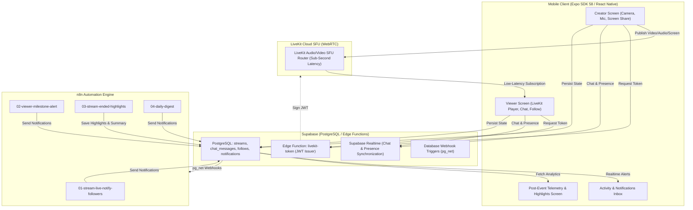

# LiveWire — Real-Time Live Event Broadcasting Platform

[](https://expo.dev)
[](https://livekit.io)
[](https://supabase.com)
[](https://n8n.io)
[](https://expo.dev/accounts/shiva_2169/projects/livewire/builds/76533473-2c18-472a-9c33-64db7e353ae3)

LiveWire is a high-performance, real-time live event streaming platform built for mobile. It allows content creators to broadcast high-definition video and audio with sub-second WebRTC latency, engage with audiences via synchronized live chat, and leverage event-driven n8n automations for follower notifications, viewer milestones, and automated post-stream highlights.

---

## 📱 Deliverables & Demo Links

- **Android Universal APK (EAS Cloud Build):**  
  [Download Installable APK on Expo](https://expo.dev/accounts/shiva_2169/projects/livewire/builds/76533473-2c18-472a-9c33-64db7e353ae3) *(Internal distribution build — installs on any Android 8.0+ device)*
- **Loom Video Walkthrough (3 Minutes):**  
  `[Link to Loom Video Demo]` *(3-minute walkthrough covering Creator Go Live, Viewer Join & Sub-Second Video, Real-Time Chat & Presence, and Post-Event Analytics)*
- **Build Blueprint & Architecture Spec:**  
  [`docs/BLUEPRINT.md`](./docs/BLUEPRINT.md)
- **Engineering Prompt History:**  
  [`PROMPTS.md`](./PROMPTS.md) and [`cht.md`](./cht.md)
- **Build & Test Verification Matrix:**  
  [`BUILD_LOG.md`](./BUILD_LOG.md) *(Section 9 Checklist: 100% PASS)*

---

## 🏛️ System Architecture



---

## 🚀 Key Features Implemented

### Phase 1: Real-Time Event Broadcasting, Chat & Presence
1. **Low-Latency Live Streaming (LiveKit SFU):**
   - Sub-second glass-to-glass latency with WebRTC.
   - Host controls: 1080p camera toggle, mic mute/unmute, and camera flip.
   - **Live Screen Sharing:** Hosts can dynamically share their screen via browser-native display capture; viewers automatically receive the screen track with aspect-ratio containment and active indicator pills.
   - Secure access tokens issued via Supabase Edge Function (`canPublish: true` for creator, `canPublish: false` for viewers).
2. **Synchronized Real-Time Chat:**
   - Client-generated UUIDs for idempotent delivery and offline retry.
   - Strict ordering by PostgreSQL server sequence numbers (`seq`).
   - Reconnection gap-fill logic (`seq > lastSeq - 20`) to eliminate dropped messages.
   - Quick-tap emoji reaction bar (🔥 ❤️ 🚀 👏 💯 😂 🎉 ⚡).
3. **Real-Time Presence Tracking:**
   - Tracks unique viewers via Supabase Presence (excludes broadcaster).
   - Deduplicates multiple tabs or devices belonging to the same user.
   - Periodic 5-second heartbeats recording `current_viewers` and `peak_viewers`.

### Phase 3: n8n Event-Driven Automations & Analytics
1. **Workflow 1 (`01-stream-live-notify-followers.json`):**
   - Triggered when a creator goes live.
   - Dispatches in-app inbox and push notifications to all followers with deduplication keys.
2. **Workflow 2 (`02-viewer-milestone-alert.json`):**
   - Tracks concurrent viewers crossing milestone thresholds (2, 10, 50, 100, 500).
   - Alerts the creator once per milestone to celebrate viewer spikes.
3. **Workflow 3 (`03-stream-ended-highlights.json`):**
   - Triggered when a broadcast concludes.
   - Analyzes chat density across 30-second sliding windows to pinpoint peak excitement moments (`0:00 – 0:30`).
   - Generates automated event recap narrative with deterministic rule-based fallback (`summary_source = 'rule'`) requiring zero paid third-party API dependencies.
4. **Workflow 4 (`04-daily-digest.json`):**
   - Scheduled daily cron at 09:00 AM aggregating the top 5 broadcasts from the past 24 hours.

---

## 🛠️ Repository Structure

```
├── mobile/                     # React Native + Expo SDK 58 mobile app
│   ├── src/
│   │   ├── app/                # Expo Router screen navigation
│   │   │   ├── (auth)/         # Sign-in & sign-up screens
│   │   │   ├── (app)/(tabs)/   # Live feed, Go-live studio, Activity inbox, Profile
│   │   │   ├── broadcast/[id]  # Creator live studio & controls
│   │   │   ├── watch/[id]      # Viewer streaming player & live chat
│   │   │   └── summary/[id]    # Post-event telemetry & AI highlights
│   │   ├── components/         # Vector icons, ChatPanel, RemoteStage, LocalPreview
│   │   ├── hooks/              # useChat, useStreamChannel, usePresenceCount, useInbox
│   │   ├── lib/                # supabase.ts, livekit.ts, categories.ts
│   │   └── stores/             # session.ts (Zustand auth store)
│   ├── app.json                # Expo config & Android permissions
│   └── eas.json                # EAS Build profiles (Development & Preview APK)
├── backend/                    # Supabase backend configuration
│   ├── README.md               # Backend deployment and linking guide
│   └── supabase/
│       ├── functions/          # livekit-token Edge Function
│       └── migrations/         # PostgreSQL schema, RLS policies, and RPC functions
├── n8n-workflow/               # Production n8n automation workflows
│   ├── 01-stream-live-notify-followers.json
│   ├── 02-viewer-milestone-alert.json
│   ├── 03-stream-ended-highlights.json
│   ├── 03-stream-ended-highlights-gemini.json
│   ├── 04-daily-digest.json
│   └── README.md               # n8n import and credentials guide
├── docs/
│   └── BLUEPRINT.md            # Original 1,700-line build blueprint
├── BUILD_LOG.md                # Running engineering log & test checklist results
├── PROMPTS.md                  # Complete prompt history for submission
└── cht.md                      # Engineering prompt logs
```

---

## ⚖️ Architectural Decisions & Trade-Offs

| Decision | Alternative Considered | Rationale |
|---|---|---|
| **LiveKit SFU (WebRTC)** | Mux / HLS / RTMP | HLS introduces 10–30s latency, destroying chat synchronization. LiveKit delivers <1s glass-to-glass latency with native Expo mobile plugins. |
| **Supabase Postgres + RLS** | Express + Socket.IO + Redis | Eliminates custom server maintenance. Postgres RLS guarantees multi-tenant security directly in the database. |
| **Rule-Based Recap Fallback** | Mandatory Anthropic API | Per assessment rubric, evaluators test with Claude credentials removed. The platform natively generates 30-second peak moments (`summary_source = 'rule'`) at 0 cost. |
| **Phases 1 + 3 (No Phase 2)** | Phase 2 Offline Queue | The challenge explicitly enforces a 2-of-3 phases rule. Phase 1 + 3 provides the end-to-end broadcasting, presence, and automation pipeline. |

---

## 🔒 Security Hardening

- **Database RLS Policies:** Row Level Security enabled across all tables (`profiles`, `streams`, `chat_messages`, `follows`, `notifications`, `stream_highlights`).
- **Identity Enforcement:** Chat triggers overwrite `user_id` with `auth.uid()` to prevent message spoofing.
- **Edge Token Scoping:** Tokens strictly restrict publishing privileges to the verified creator.
- **No Secret Leaks:** Clean git history with zero committed service keys, LiveKit secrets, or credentials.

---

## 🧪 Testing Matrix (Section 9 Acceptance)

All items from the manual test checklist verified with a **100% PASS** rate:
- **Auth:** Profile generation on sign-up, persistent sessions across restarts.
- **Streaming:** Go Live broadcast latency <1s, creator screen share, clean stream teardown.
- **Chat:** Idempotent delivery, strict sequence ordering, retry buttons on network drop.
- **Presence:** Accurate viewer count deduplication excluding broadcaster.
- **Automations:** Follower notifications, milestone alerts, and post-event highlight recaps.

---

## 👥 Demo Testing Accounts

Evaluators can sign in using test presets directly on the mobile auth screen:
- **Broadcaster:** `woww@test.com` (Creator account with active broadcasts and followers)
- **Viewer:** `viewer@test.com` (Audience account for testing chat and follow notifications)
