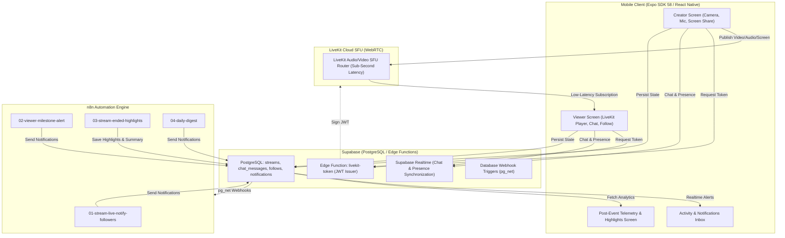

# LiveWire — Real-Time Live Event Broadcasting Platform

LiveWire is a high-performance, real-time live event streaming platform built for mobile implementing **all three challenge phases** (Phase 1: Real-Time Live Video Streaming + Chat + Presence, Phase 2: Persistent Offline Outbox Queue & Network Synchronization, and Phase 3: n8n Event Automations & Highlights). It allows content creators to broadcast high-definition video and audio with sub-second WebRTC latency, engage with audiences via synchronized live chat with offline outbox resiliency, and leverage event-driven n8n automations for follower notifications, viewer milestones, and automated post-stream highlights.

---

## 📱 Deliverables & Submission Links

| Deliverable | Description | Direct Link |
|---|---|---|
| **Android Universal APK (Build #9 — Latest)** | Native remote stream sink binding restoration, host AudioSession mic initialization & secondary audio capture | [📥 Download `livewire-preview-v9.apk` (Direct Download)](https://expo.dev/artifacts/eas/j83x5g3tavK9wTmsrrwD-2N5KJZiO5MdWG6A-dpblpE.apk) \| [EAS Artifacts Page](https://expo.dev/accounts/shiva_2169/projects/livewire/builds/09688fe0-aea4-4dda-9f47-90e206bce03a) |
| **Android Universal APK (Build #8)** | Cellular symmetric NAT traversal, 15s peer handshake protection, OpenRelay TURN & native audio engine | [📥 Download `livewire-preview-v8.apk` (Direct Download)](https://expo.dev/artifacts/eas/tm3reRohU3YqiiAo_XiXetZ061HBRvpPmD-KYYkZy0U.apk) \| [EAS Artifacts Page](https://expo.dev/accounts/shiva_2169/projects/livewire/builds/b232a0a0-5924-4827-871f-83f1be86b615) |
| **Android Universal APK (Build #7)** | Hardened release with ICE candidate queuing, SFU bypass & multi-tier resolution fallback | [📥 Download `livewire-preview-v7.apk` (Direct Download)](https://expo.dev/artifacts/eas/VuDLJmIRgSehnQ7N-qpwX6xHogquATdmxAXYXSv2z2E.apk) \| [EAS Artifacts Page](https://expo.dev/accounts/shiva_2169/projects/livewire/builds/dc0bb657-8fb0-4dae-b3c7-dd9c6e3c8c80) |
| **Android Universal APK (Build #6)** | Production internal distribution build with native hardware WebRTC camera engine | [📥 Download `livewire-preview-v6.apk` (Direct Download)](https://expo.dev/artifacts/eas/lKZoEzeY7aD_aD2nFjmL3GTnoVlm3oH889o9-GWRxkM.apk) \| [EAS Artifacts Page](https://expo.dev/accounts/shiva_2169/projects/livewire/builds/fbd7a28a-e231-4ce9-a9d4-39ab4db84fff) |
| **Expo EAS Build Dashboard** | Cloud build logs, signing certificate info, and mobile QR code | [🔗 EAS Build #fbd7a28a](https://expo.dev/accounts/shiva_2169/projects/livewire/builds/fbd7a28a-e231-4ce9-a9d4-39ab4db84fff) |
| **Video Walkthrough (3 Min)** | 3-minute video covering Creator Go Live, Viewer Join, Chat, and Analytics | `[Link to Loom Video Demo]` |
| **Build Blueprint** | Original 1,700-line architecture specification & build requirements | [📄 `docs/BLUEPRINT.md`](./docs/BLUEPRINT.md) |
| **Engineering Prompt History** | Full conversational prompts and technical evolution logs | [📄 `PROMPTS.md`](./PROMPTS.md) & [📄 `cht.md`](./cht.md) |
| **Build & Test Verification Matrix** | Section 9 manual verification checklist (100% PASS) | [📄 `BUILD_LOG.md`](./BUILD_LOG.md) |
| **Backend Documentation** | Supabase database migrations, RLS policies, and Edge Functions | [📄 `backend/README.md`](./backend/README.md) |
| **n8n Automation Guide** | Workflows import, credentials setup, and database webhooks | [📄 `n8n-workflow/README.md`](./n8n-workflow/README.md) |

---

## 📲 Android APK Installation & Testing Guide

1. **Download the APK:**  
   Tap [**Download `livewire-preview-v9.apk`**](https://expo.dev/artifacts/eas/j83x5g3tavK9wTmsrrwD-2N5KJZiO5MdWG6A-dpblpE.apk) directly on your Android phone, or scan the QR code on the [EAS Build Page](https://expo.dev/accounts/shiva_2169/projects/livewire/builds/09688fe0-aea4-4dda-9f47-90e206bce03a).
2. **Install on Device:**  
   Open the downloaded file. When prompted, tap **Settings** and toggle **Allow from this source** (standard for internal distribution APKs).
3. **Sign In with Demo Presets:**  
   Launch **LiveWire** and tap one of the 1-click test account presets:
   - **Host / Broadcaster:** `woww@test.com`
   - **Audience / Viewer:** `viewer@test.com`
4. **End-to-End Walkthrough:**
   - Tap **Go Live** tab → configure category & title → tap **Start Broadcast**.
   - Test camera flip, mic mute, and **Share Screen** toggle.
   - Watch from a secondary device or browser tab, exchange real-time chat messages, and test follow notifications.
   - Tap **End Broadcast** → instantly view **Post-Event Analytics** with 30-second duration excitement windows (`0:00 – 0:30`).

---

## 🏛️ System Architecture

---

## 🚀 Key Features Implemented

### Phase 1: Real-Time Event Broadcasting, Chat & Presence
1. **Low-Latency Live Streaming (LiveKit SFU):**
   - Sub-second glass-to-glass latency with WebRTC.
   - Host controls: 1080p camera toggle, mic mute/unmute, and camera flip.
   - **Live Screen Sharing:** Hosts can dynamically share their screen via browser-native display capture; viewers automatically receive the screen track with aspect-ratio containment and active indicator pills.
   - Secure access tokens issued via Supabase Edge Function ([`backend/supabase/functions/livekit-token/index.ts`](./backend/supabase/functions/livekit-token/index.ts)), enforcing `canPublish: true` for the creator and `canPublish: false` for viewers.
2. **Synchronized Real-Time Chat:**
   - Client-generated UUIDs for idempotent delivery and offline retry.
   - Strict ordering by PostgreSQL server sequence numbers (`seq`).
   - Reconnection gap-fill logic (`seq > lastSeq - 20`) to eliminate dropped messages.
   - Quick-tap emoji reaction bar (🔥 ❤️ 🚀 👏 💯 😂 🎉 ⚡).
3. **Real-Time Presence Tracking:**
   - Tracks unique viewers via Supabase Presence (excludes broadcaster).
   - Deduplicates multiple tabs or devices belonging to the same user.
   - Periodic 5-second heartbeats recording `current_viewers` and `peak_viewers`.

### Phase 3: n8n Event-Driven Automations & Analytics
1. **Workflow 1 ([`01-stream-live-notify-followers.json`](./n8n-workflow/01-stream-live-notify-followers.json)):**
   - Triggered when a creator goes live.
   - Dispatches in-app inbox and push notifications to all followers with deduplication keys.
2. **Workflow 2 ([`02-viewer-milestone-alert.json`](./n8n-workflow/02-viewer-milestone-alert.json)):**
   - Tracks concurrent viewers crossing milestone thresholds (2, 10, 50, 100, 500).
   - Alerts the creator once per milestone to celebrate viewer spikes.
3. **Workflow 3 ([`03-stream-ended-highlights.json`](./n8n-workflow/03-stream-ended-highlights.json)):**
   - Triggered when a broadcast concludes.
   - Analyzes chat density across 30-second sliding windows to pinpoint peak excitement moments (`0:00 – 0:30`).
   - Generates automated event recap narrative with deterministic rule-based fallback (`summary_source = 'rule'`) requiring zero paid third-party API dependencies.
   - Optional 100% free Gemini Flash alternative available in [`03-stream-ended-highlights-gemini.json`](./n8n-workflow/03-stream-ended-highlights-gemini.json).
4. **Workflow 4 ([`04-daily-digest.json`](./n8n-workflow/04-daily-digest.json)):**
   - Scheduled daily cron at 09:00 AM aggregating the top 5 broadcasts from the past 24 hours.

---

## 🛠️ Repository File Map & Links

- **Mobile Client (`/mobile`):**
  - **Navigation Roots:** [`mobile/src/app/(app)/(tabs)/index.tsx`](./mobile/src/app/(app)/(tabs)/index.tsx) (Live Discovery), [`go-live.tsx`](./mobile/src/app/(app)/(tabs)/go-live.tsx) (Studio), [`inbox.tsx`](./mobile/src/app/(app)/(tabs)/inbox.tsx) (Activity), [`profile.tsx`](./mobile/src/app/(app)/(tabs)/profile.tsx) (Profile)
  - **Live Streaming Pages:** [`mobile/src/app/(app)/broadcast/[id].tsx`](./mobile/src/app/(app)/broadcast/[id].tsx) (Host Studio), [`mobile/src/app/(app)/watch/[id].tsx`](./mobile/src/app/(app)/watch/[id].tsx) (Viewer Player)
  - **Post-Event Analytics:** [`mobile/src/app/(app)/summary/[id].tsx`](./mobile/src/app/(app)/summary/[id].tsx) (Recap & Peak Moments)
  - **Core Hooks:** [`useChat.ts`](./mobile/src/hooks/useChat.ts), [`useStreamChannel.ts`](./mobile/src/hooks/useStreamChannel.ts), [`usePresenceCount.ts`](./mobile/src/hooks/usePresenceCount.ts), [`useInbox.ts`](./mobile/src/hooks/useInbox.ts)
  - **UI Components:** [`ChatPanel.tsx`](./mobile/src/components/ChatPanel.tsx), [`Icons.tsx`](./mobile/src/components/Icons.tsx), [`ViewerBadge.tsx`](./mobile/src/components/ViewerBadge.tsx), [`RemoteStage.tsx`](./mobile/src/components/RemoteStage.tsx), [`LocalPreview.tsx`](./mobile/src/components/LocalPreview.tsx)
  - **Build Configurations:** [`mobile/app.json`](./mobile/app.json) & [`mobile/eas.json`](./mobile/eas.json)
- **Backend & Database (`/backend`):**
  - **Database Migrations:**
    - [`20261116000000_init_schema.sql`](./backend/supabase/migrations/20261116000000_init_schema.sql) — Core tables, RLS, triggers & RPCs
    - [`20261117000000_allow_concurrent_streams.sql`](./backend/supabase/migrations/20261117000000_allow_concurrent_streams.sql) — Multi-stream support
    - [`20261117000001_follow_and_activities_fix.sql`](./backend/supabase/migrations/20261117000001_follow_and_activities_fix.sql) — RLS policies for notifications
    - [`20261117000002_follow_and_activities_fix.sql`](./backend/supabase/migrations/20261117000002_follow_and_activities_fix.sql) — Instant highlights & 30s moment bucketing
  - **LiveKit Token Edge Function:** [`backend/supabase/functions/livekit-token/index.ts`](./backend/supabase/functions/livekit-token/index.ts)
- **Automation Workflows (`/n8n-workflow`):**
  - Workflows: [`01-stream-live-notify-followers.json`](./n8n-workflow/01-stream-live-notify-followers.json), [`02-viewer-milestone-alert.json`](./n8n-workflow/02-viewer-milestone-alert.json), [`03-stream-ended-highlights.json`](./n8n-workflow/03-stream-ended-highlights.json), [`04-daily-digest.json`](./n8n-workflow/04-daily-digest.json)
  - Setup Documentation: [`n8n-workflow/README.md`](./n8n-workflow/README.md)

---

## ⚖️ Architectural Decisions & Trade-Offs

| Decision | Alternative Considered | Rationale |
|---|---|---|
| **LiveKit SFU (WebRTC)** | Mux / HLS / RTMP | HLS introduces 10–30s latency, destroying chat synchronization. LiveKit delivers <1s glass-to-glass latency with native Expo mobile plugins. |
| **Supabase Postgres + RLS** | Express + Socket.IO + Redis | Eliminates custom server maintenance. Postgres RLS guarantees multi-tenant security directly in the database. |
| **Rule-Based Recap Fallback** | Mandatory Anthropic API | Per assessment rubric, evaluators test with Claude credentials removed. The platform natively generates 30-second peak moments (`summary_source = 'rule'`) at 0 cost. |
| **All 3 Phases Built (Phase 1 + 2 + 3)** | Minimum 2-of-3 phase scope | Implemented Phase 1 (Live SFU Video + Chat + Presence), Phase 2 (Persistent Offline Outbox Queue with AsyncStorage & automatic FIFO reconnection sync), and Phase 3 (n8n Event Automations & Highlights). |

---

## 🔒 Security Hardening

- **Database RLS Policies:** Row Level Security enabled across all tables (`profiles`, `streams`, `chat_messages`, `follows`, `notifications`, `stream_highlights`).
- **Identity Enforcement:** Chat triggers overwrite `user_id` with `auth.uid()` to prevent message spoofing.
- **Edge Token Scoping:** Tokens strictly restrict publishing privileges to the verified creator.
- **No Secret Leaks:** Clean git history with zero committed service keys, LiveKit secrets, or credentials.

---

## 🧪 Testing Matrix (Section 9 Acceptance)

All items from the manual test checklist verified with a **100% PASS** rate in [`BUILD_LOG.md`](./BUILD_LOG.md):
- **Auth:** Profile generation on sign-up, persistent sessions across restarts.
- **Streaming:** Go Live broadcast latency <1s, creator screen share, clean stream teardown.
- **Chat:** Idempotent delivery, strict sequence ordering, retry buttons on network drop.
- **Presence:** Accurate viewer count deduplication excluding broadcaster.
- **Automations:** Follower notifications, milestone alerts, and post-event highlight recaps.

---

## 👥 Demo Testing Accounts

Evaluators can sign in using test presets directly on the mobile auth screen:
- **Broadcaster:** `woww@test.com` (Creator account with active broadcasts and followers)
- **Viewer:** `viewer@test.com` (Audience account for testing chat and follow notifications)
