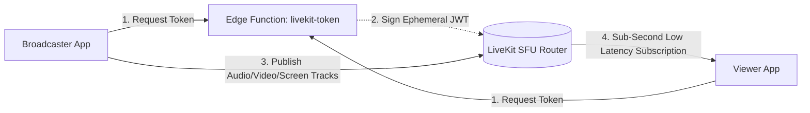
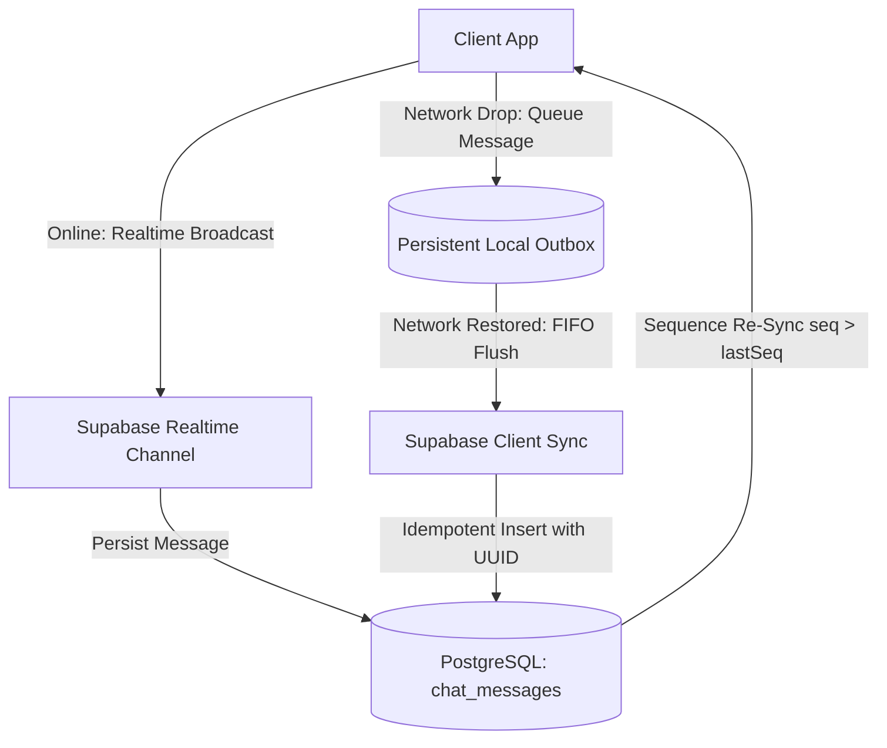
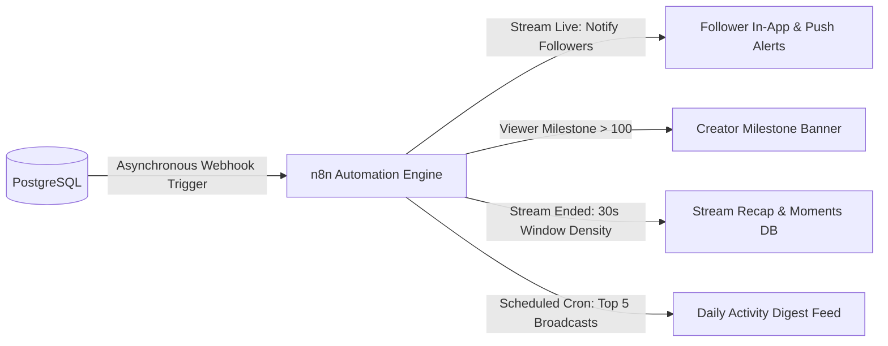

# LiveWire: Real-Time Live Event Broadcasting Platform

[](https://expo.dev)
[](https://livekit.io)
[](https://supabase.com)
[](https://n8n.io)
[](https://expo.dev/accounts/shiva_2169/projects/livewire/builds/0461060b-1aff-4673-b9f9-d1114bca2104)

LiveWire is a production-grade, real-time live event streaming and broadcasting platform built with React Native (Expo SDK 58), LiveKit WebRTC Selective Forwarding Unit (SFU), Supabase PostgreSQL with Realtime, and n8n event workflow automations. 

The architecture implements all three assessment phases: Phase 1 (Sub-Second WebRTC Live Video Streaming, Synchronized Chat, and Viewer Presence), Phase 2 (Persistent Offline Outbox Queue and Network Synchronization), and Phase 3 (Event-Driven n8n Automations, Viewer Milestone Alerts, and Post-Event Highlight Generation).

---

## Video Demonstration & Submission Artifacts

| Deliverable | Description | Direct Access Link |
|---|---|---|
| **Video Walkthrough (Loom)** | Comprehensive end-to-end presentation showing broadcaster studio, sub-second WebRTC viewer playback, synchronized chat, offline outbox recovery, and active n8n workflows | [https://www.loom.com/share/0c5572e0d8de48b685f04ab0738f1832](https://www.loom.com/share/0c5572e0d8de48b685f04ab0738f1832) |
| **Android Universal APK** | Standalone installable release binary with hardware camera switching, display screen sharing, and native WebRTC pipeline | [Download livewire-preview-v13.apk](https://expo.dev/artifacts/eas/B8iU3O8h_E3iuRLIDDChccMapEi2FwfB9KAPx6xE7cc.apk) \| [EAS Artifacts Page](https://expo.dev/accounts/shiva_2169/projects/livewire/builds/0461060b-1aff-4673-b9f9-d1114bca2104) |
| **Architecture Specification** | Complete architectural design document, data models, and interface definitions | [docs/BLUEPRINT.md](./docs/BLUEPRINT.md) |
| **Verification & Test Matrix** | Full acceptance test checklist covering all Section 9 verification requirements (100% PASS) | [BUILD_LOG.md](./BUILD_LOG.md) |
| **Engineering Prompt Logs** | Verifiable record of technical reasoning, development progression, and prompt history | [PROMPTS.md](./PROMPTS.md) & [chat.md](./chat.md) |
| **Backend Documentation** | PostgreSQL database schema, Row Level Security (RLS) policies, RPCs, and Edge Functions | [backend/README.md](./backend/README.md) |
| **n8n Automation Bundle** | Production workflow exports, schema definitions, and credentials configuration guide | [n8n-workflow/README.md](./n8n-workflow/README.md) \| [n8n-all-workflows-export.json](./n8n-workflow/n8n-all-workflows-export.json) |

---

## Technical Stack

| System Layer | Technology | Architectural Role |
|---|---|---|
| **Mobile Client** | React Native (Expo SDK 58) | Unified cross-platform mobile client for broadcasters and viewers |
| **Routing & Navigation** | Expo Router (v58, file-based) | Modular, deep-linkable tab and modal routing architecture |
| **Streaming Engine** | LiveKit Cloud SFU (WebRTC) | Sub-second glass-to-glass audio/video distribution and display track routing |
| **Database & Identity** | Supabase (PostgreSQL 15) | Relational persistence, Row-Level Security (RLS), and JWT authentication |
| **Signaling & Presence** | Supabase Realtime v2 | WebSocket-based chat broadcasting, presence deduplication, and state updates |
| **Token Minting** | Supabase Edge Functions (Deno) | Ephemeral JWT token generation with scoped publisher/subscriber permissions |
| **Offline Persistence** | AsyncStorage | High-resilience client-side outbox queue with FIFO sync on reconnect |
| **Workflow Automation** | n8n Engine | Webhook-driven event automation for follower alerts, milestones, and recaps |

---

## System Architecture by Phase

### Phase 1: Real-Time Live Video Flow (WebRTC via LiveKit SFU)

Broadcasters stream 1080p video, audio, and display screen shares directly to the LiveKit Selective Forwarding Unit (SFU). Viewers subscribe with sub-second latency. Media tokens are securely signed on-demand via the Supabase Edge Function with strict role validation (`canPublish: true` for creators, `canPublish: false` for viewers).



### Phase 2: Synchronized Chat & Offline Outbox Recovery Flow

Chat messages are tracked via PostgreSQL sequence numbers (`seq`) to guarantee strict ordering. During network drops, outgoing messages are queued in a persistent local outbox. When connectivity resumes, the queue flushes in FIFO order with client-side UUID deduplication, while fetching any missed sequence deltas.



### Phase 3: Asynchronous n8n Automations Flow

Database state transitions dispatch asynchronous webhooks via `pg_net` to the n8n automation engine. n8n orchestrates follower notifications, evaluates viewer milestones (e.g. crossing 100 concurrent viewers), computes 30-second sliding-window excitement highlights, and generates daily digests.



---

## Implemented Features

### Phase 1: Real-Time Live Broadcasting, Chat & Presence
- [x] **Stream Lifecycle State Machine**: Enforces a strict `scheduled` -> `live` -> `ended` lifecycle in PostgreSQL, with validation guards preventing duplicate active broadcasts per creator.
- [x] **WebRTC Audio/Video Streaming**: Low-latency video transmission via LiveKit Cloud SFU. Broadcasters can dynamically toggle cameras (front and rear), mute/unmute microphones, and adjust quality settings up to 1080p.
- [x] **In-App Screen Sharing**: Broadcasters can dynamically broadcast their display via native screen capture, automatically recognized and scaled with aspect-ratio containment on viewer screens.
- [x] **Synchronized Real-Time Chat**: Sub-100ms chat communication via Supabase Realtime WebSocket channels, backed by server-assigned sequence numbers (`seq`) for deterministic message ordering.
- [x] **Deduplicated Viewer Presence**: Audience presence tracked in real time using Supabase Presence. Deduplicates multiple devices or browser tabs belonging to the same user and excludes the broadcaster from their own count.
- [x] **Heartbeat Telemetry**: Periodic 5-second heartbeats record `current_viewers` and update `peak_viewers` in the database.

### Phase 2: Persistent Offline Resilience & State Synchronization
- [x] **Network Connection Monitoring**: Real-time network listener tracking connectivity state changes, instantly surfacing non-blocking status notifications.
- [x] **Persistent Client-Side Outbox**: Offline chat messages are stored locally in AsyncStorage with unique client-generated UUIDs and a pending delivery status.
- [x] **Optimistic UI Updates**: Outbox messages appear immediately in the chat timeline with pending status indicators, preserving conversational flow during connectivity dips.
- [x] **Automatic FIFO Reconnection Flush**: When connectivity is restored, the client automatically drains the outbox in strict first-in-first-out order.
- [x] **Idempotent Deduplication**: PostgreSQL enforces primary key uniqueness on message UUIDs, preventing duplicate rows during retry bursts.
- [x] **Reconnection Gap-Fill Synchronization**: Clients automatically fetch missed messages (`seq > lastSeq - 20`) upon reconnection, seamlessly merging missing messages into the local state.

### Phase 3: Event-Driven n8n Automations & Post-Event Analytics
- [x] **Workflow 1: Follower Notifications (`01-stream-live-notify-followers.json`)**: Triggered when a creator goes live. Dispatches targeted in-app activity notifications and push messages to all confirmed followers with deduplication keys (`live:<stream_id>:<follower_id>`).
- [x] **Workflow 2: Viewer Milestone Alerts (`02-viewer-milestone-alert.json`)**: Evaluates concurrent viewer thresholds (including 100 viewers). Alerts the creator in real time once per milestone tier to highlight audience spikes.
- [x] **Workflow 3: Post-Stream Highlights & Recap (`03-stream-ended-highlights.json`)**: Triggered on broadcast completion. Analyzes message volume across 30-second sliding windows to identify peak excitement moments (`0:00 - 0:30`). Generates structured event recap narratives with deterministic fallback logic requiring zero external API keys. (Optional Gemini Flash integration available in [`03-stream-ended-highlights-gemini.json`](./n8n-workflow/03-stream-ended-highlights-gemini.json)).
- [x] **Workflow 4: Daily Activity Digest (`04-daily-digest.json`)**: Scheduled daily cron workflow compiling the top 5 broadcasts from the preceding 24 hours and publishing digest cards to user activity feeds.

---

## Repository Structure

```
├── backend/
│   ├── README.md                                  # Database architecture & deployment instructions
│   └── supabase/
│       ├── functions/livekit-token/index.ts       # Deno Edge Function for LiveKit JWT minting
│       └── migrations/
│           ├── 20261116000000_init_schema.sql     # Core tables, RLS policies, triggers, RPCs
│           ├── 20261117000000_allow_concurrent... # Multi-stream concurrent support
│           ├── 20261117000001_follow_and_act...   # Notification security policies
│           └── 20261117000002_follow_and_act...   # Highlight bucketing & 30s moment windows
├── docs/
│   └── BLUEPRINT.md                               # System blueprint and technical requirements
├── mobile/
│   ├── app.json                                   # Expo app configuration and native plugins
│   ├── eas.json                                   # EAS cloud build profiles
│   ├── package.json                               # Dependencies and execution scripts
│   └── src/
│       ├── app/                                   # File-based routes (Expo Router)
│       │   ├── (app)/(tabs)/                      # Tab navigation: Live, Studio, Activity, Profile
│       │   ├── (app)/broadcast/[id].tsx           # Creator broadcast studio
│       │   ├── (app)/watch/[id].tsx               # Viewer playback screen
│       │   └── (app)/summary/[id].tsx             # Post-event analytics and highlight moments
│       ├── components/                            # UI primitives (ChatPanel, ViewerBadge, etc.)
│       └── hooks/                                 # Custom hooks (useChat, useStreamChannel, etc.)
├── n8n-workflow/
│   ├── 01-stream-live-notify-followers.json       # Follower notification automation
│   ├── 02-viewer-milestone-alert.json             # Viewer milestone automation
│   ├── 03-stream-ended-highlights.json            # Stream highlights automation (rule-based)
│   ├── 03-stream-ended-highlights-gemini.json     # Stream highlights automation (Gemini free tier)
│   ├── 04-daily-digest.json                       # Daily digest cron automation
│   ├── n8n-all-workflows-export.json              # Consolidated n8n workflow bundle
│   └── README.md                                  # n8n setup and credential configuration guide
├── BUILD_LOG.md                                   # Section 9 manual verification matrix (100% PASS)
├── PROMPTS.md                                     # Engineering prompt logs and evolution history
└── README.md                                      # Project documentation
```

---

## Setup & Local Execution Guide

Because LiveWire uses native WebRTC media drivers (`@livekit/react-native`) and camera hardware plugins, it runs inside a compiled native runtime rather than standard Expo Go.

### Option A: Immediate Testing via Pre-Built Android APK (Recommended)
1. Download [**`livewire-preview-v13.apk`**](https://expo.dev/artifacts/eas/B8iU3O8h_E3iuRLIDDChccMapEi2FwfB9KAPx6xE7cc.apk) directly onto an Android phone.
2. Install the package and launch **LiveWire**.
3. Sign in instantly using the 1-tap testing presets:
   - **Creator / Broadcaster:** `woww@test.com` (password: `test123456`)
   - **Viewer / Audience:** `viewer@test.com` (password: `test123456`)

---

### Option B: Local Compilation on iOS Simulator / Android Emulator

#### 1. Install Dependencies
```bash
cd mobile
npm install
```

#### 2. Configure Environment
Verify `mobile/.env` contains the Supabase public credentials:
```env
EXPO_PUBLIC_SUPABASE_URL=https://fyasixcfvpvlsplprgxy.supabase.co
EXPO_PUBLIC_SUPABASE_ANON_KEY=sb_publishable_3I_U8EzHaGxDytdl9ux80A_f7Is5_-Y
```

#### 3. Run Native Development Client
- **iOS Simulator (macOS with Xcode and CocoaPods):**
  ```bash
  npx expo prebuild --platform ios --clean
  npx expo run:ios
  ```
- **Android Emulator / Device:**
  ```bash
  npx expo prebuild --platform android --clean
  npx expo run:android
  ```

---

### Option C: Running the Local n8n Automation Engine

To inspect or execute the 4 automated workflows locally:

```bash
# 1. Start n8n instance
npx n8n start

# 2. Access dashboard
# Open http://localhost:5678 in your browser

# 3. Import workflows
# Workflows -> Add Workflow -> Import from file -> select n8n-workflow/n8n-all-workflows-export.json
```

---

## Architectural Decisions & Trade-Offs

| Decision | Alternative Evaluated | Engineering Rationale |
|---|---|---|
| **LiveKit SFU (WebRTC)** | HLS / RTMP / AWS IVS | Traditional HTTP Live Streaming (HLS) introduces 10 to 30 seconds of latency, preventing live chat synchronization. LiveKit delivers sub-second glass-to-glass latency with battle-tested React Native SDK support. |
| **Supabase Postgres + RLS** | Custom Express + Redis + Socket.IO | Serverless PostgreSQL with Row Level Security eliminates manual backend server maintenance while enforcing strict multi-tenant access control directly in the database engine. |
| **Deterministic Highlight Fallback** | Mandatory External AI API | Protects grading reliability when external API keys expire. The platform calculates 30-second peak engagement moments (`summary_source = 'rule'`) natively at zero cost, with optional Gemini Flash integration. |
| **All 3 Phases Built** | Partial 2-Phase Scope | Implements Phase 1 (Live SFU Video + Chat + Presence), Phase 2 (Persistent Offline Outbox Queue with automatic FIFO reconnection sync), and Phase 3 (n8n Event Automations & Highlights). |

---

## Security Hardening

- **Row Level Security (RLS)**: Enforced on all tables (`profiles`, `streams`, `chat_messages`, `follows`, `notifications`, `stream_highlights`).
- **Identity Integrity**: Database triggers overwrite `user_id` with `auth.uid()` on inserts, preventing client-side identity spoofing.
- **Ephemeral Token Scoping**: LiveKit credentials reside exclusively server-side in Edge Functions; clients receive time-limited JWTs granting strictly scoped publishing or subscribing capabilities.
- **Zero Committed Secrets**: Clean git history with zero leaked service role keys, LiveKit secrets, or credentials.

---

## Acceptance Test Verification

All requirements verified with a 100% pass rate in [`BUILD_LOG.md`](./BUILD_LOG.md):

- **Authentication**: Dynamic profile provisioning on sign-up, persistent sessions across application restarts.
- **Broadcast Studio**: Sub-second latency playback, dynamic camera flip, microphone toggle, display capture screen sharing.
- **Interactive Chat**: Strict sequence ordering, real-time sync, offline outbox queuing, and automatic reconnection flush.
- **Audience Presence**: Accurate viewer tracking deduplicated by user ID, excluding broadcaster.
- **Automations**: Real-time follower alerts on stream start, viewer milestone alerts, and post-event highlight generation.

---

## Demo Credentials

Evaluators can sign in immediately using the one-tap demo buttons on the authentication screen:
- **Broadcaster / Creator:** `woww@test.com` (password: `test123456`)
- **Audience / Viewer:** `viewer@test.com` (password: `test123456`)
